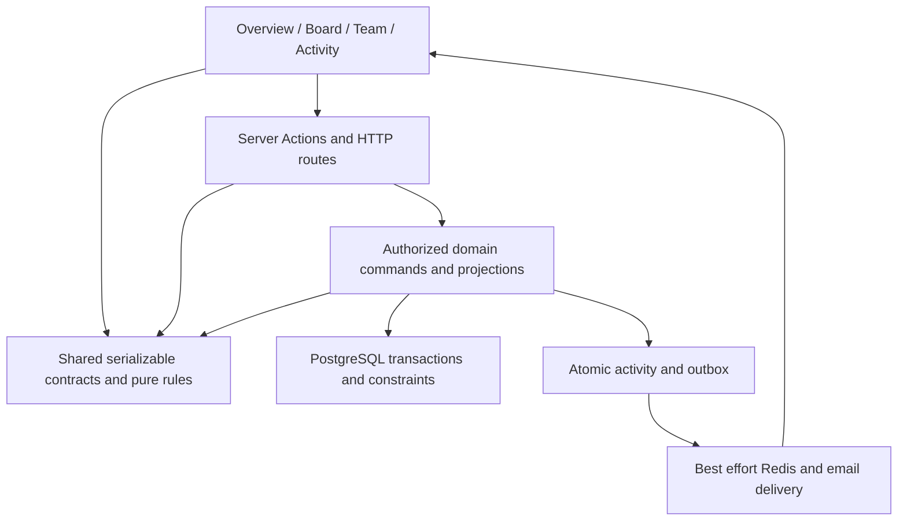

# Core foundation review and completion order

Date: 2026-10-04. Scope: current local implementation and authorized test resources. This is a source review with selected executed regressions, not a production certification or a whole-repository security audit. Earlier readiness documents are historical snapshots.

## Decision

Keep the current Next.js application, PostgreSQL domain commands, transactional activity/outbox, and Redis/SSE transport. The main durable ownership model is sound. Improve contracts, asynchronous state recovery, and uncovered lifecycle behavior before adding AI or moving to a different stack.

Three approaches were considered:

1. Incremental fixes at existing interfaces, with regressions and compatibility exports. Recommended: small changes provide evidence and preserve the current two-stage Overview/Board experience.
2. Extract all dashboard and data logic into feature folders immediately. This could improve navigation, but moving unresolved behavior would leave the same defects behind new paths. Extract a module only when its responsibility and tests are clear.
3. Rewrite the application or add a generic service/repository framework. Rejected: there is no measured requirement that justifies the migration cost or additional interfaces.

## Dependency direction

UI presentation may check capabilities for usability; verified server identity and current domain authorization still decide access. Notifications prompt reconciliation and never replace durable state. Shared contracts must not import application entry points.

## Findings addressed in this pass

| Finding | Change | Evidence and limit |
| --- | --- | --- |
| Task data imported validation and Task from application modules; Board duplicated the Task shape | Shared lib/task-contract.ts owns Task, TaskStatus and update validation. Existing app exports remain compatible; Board and task draft reuse the shared contract | Domain import regression failed before and passed after; existing action contract checks and type checking pass |
| Comment reads could complete out of order, and submit plus realtime could render one comment twice | Scoped read generations, task cleanup and ID deduplication in the existing component | Controlled runtime component tests failed before and passed after; no React DOM test framework was added |
| Thrown comment requests could leave loading stuck or escape recovery; unknown save outcomes could be blindly replayed | Catch transport failures, retain the draft, expose Refresh comments and block resubmission until an authoritative read succeeds | Runtime tests cover thrown reads/saves, retry and task switches. This does not add durable comment idempotency |
| Archived comments and activity were denied to current members, contradicting the approved read-only archive requirement | Allow member-scoped archived reads; reject new comments on archived workspaces | Current database regression verifies archived reads, denied writes, outsiders and removed members |
| Comment lists projected each record with another SQL query | One joined projection and a private shared mapper | Two records previously required five statements; now three regardless of record count. Empty lists and tied timestamps are tested. No latency claim is inferred |
| Joined comment FOR UPDATE did not establish the explicit workspace-before-task order used by other commands | Lock workspace, recheck archive state, then lock task and check membership | Statement-order runtime regression plus real database command checks. No real concurrent deadlock reproduction or load measurement is claimed |
| CSV unexpected thrown errors were returned verbatim | Sanitized row failure with Board reconciliation guidance | Actual action executed with stubbed dependencies; byte/row/permission/flag bounds and partial metadata/results checked. No durable whole-file retry guarantee |
| Usage authorized in the route and aggregated in a separate read | getWorkspaceUsage(workspaceId, actorId) now authorizes and aggregates in one repeatable-read transaction; HTTP shape is retained and successful responses are private/no-store | Database outsider/removed-member and completion-transition checks; HTTP 401/400/403/200/503 checks |
| Archived history had no reachable UI or archive-state projection | Explicit archived list and archivedAt projection; authenticated /archive page linked from Dashboard; shared task dialog and activity with task/comment write controls absent | Discoverability regression failed before and passed after; default workspace list remains active-only; browser evidence recorded in release ledger |
| Development module reloads created separate database clients | Reuse one lazy pooled client across development reloads; production module lifetime remains unchanged | Two-module runtime regression failed before and passed after. Session pool exhaustion was observed during testing; this is not proof that every provider connection was caused by reloads |
| Framework development function logging included invocation arguments | Disable serverFunctions logging in the installed framework's supported configuration | Executed config regression; ordinary request logs remain enabled. No credential values are recorded in this document |

## Remaining foundation and functional gaps

| Priority | Verified source finding or evidence gap | Recommended next change | Acceptance |
| --- | --- | --- | --- |
| 1 | Remaining FRS evidence is incomplete despite the corrected archive flow | Finish auth/provider, CSV persistence, stale-edit, rendered failure, flag-mode and role-transition journeys | Each scenario has input, outcome, permission and persistence evidence; failures are corrected before any complete label |
| 1 | Ownership transfer and usage now have focused command tests; browser/API integration beyond the controlled checks is still incomplete | Finish the role-transition and usage browser journeys with the existing QA sessions | New owner controls administration; former owner retains only member rights; usage persists after refresh |
| 2 | hooks/use-workspaces.ts combines initial loads, selection, notifications, realtime recovery and mutation flows. Task command duplicate refreshes and selection contamination are now covered and corrected | Extend initial-load/realtime and workspace mutation behavior coverage before extracting the smallest task-state module | No late response contaminates another selection; one authoritative recovery for a failed command; optimistic state reverts or reconciles |
| 2 | Dashboard and TaskList each contain navigation/form/dialog responsibilities; TaskList is roughly 830 lines | Extract the existing task detail dialog and task creation form only after their role/error/state tests are stable. Keep one shared renderer and one command path | Existing Overview/Board entry paths, keyboard focus, role controls and recovery remain unchanged |
| 2 | UI permissions compare normalized emails while domain permissions compare user IDs | Reuse the pure task policy for presentation with a deliberate identity mapping, or migrate projections/callers to stable user IDs in one tested slice | Owner/creator/assignee/member matrix agrees with the domain; UI never becomes an authorization source |
| 2 | Workspace lists still use one ID query and two projection queries per workspace | Measure typical list size before adopting a set-based workspace/member projection; keep read isolation and deterministic order | Correct memberships/owner and empty results; SQL count and representative timing |
| 2 | Many existing UI tests assert source text; only selected new tests execute real functions with controlled dependencies | Increase behavior coverage for critical transitions; retain architecture checks for actual dependency rules | Critical role, failure, persistence and switching scenarios are executable, not inferred from labels or source strings |
| Operational | Current local Redis is a development mock; email delivery is unconfigured. Capacity, revocation timing, backup restore and alert drills are not proven | Use controlled real test providers and an approved disposable restore target. Keep fresh deployment setup for deployment day | Measured NFR targets, observed recovery/alerts and recorded ownership/cost |

Large files alone are not proof of a faulty architecture. A broader rewrite is not needed to close the remaining acceptance gaps.

Independent review follow-up: saved comments now reconcile retained and concurrent history after invalidating pending reads, verified by a runtime race regression. Archived member removal and workspace deletion now reject while holding the workspace lock, verified against the current test database. The member archive browser journey passed discovery, disabled task fields, absent Save/composer, retained discussion, page refresh and activity history. Final ordinary suite: 171 passed, one skipped; database suite: 36 passed, with affected workspace checks rerun after review fixes. Build/type checking and lint passed.

## Current functional acceptance ledger

PASS below refers only to the named scenarios. It does not mean every case in the requirement is complete.

| Requirement | Current evidence | Still open |
| --- | --- | --- |
| FR01 authentication | Independent seeded QA password sessions and refresh verified | Signup delivery, OAuth, recovery email and expiry journeys |
| FR02 workspace lifecycle | Database create/atomicity/owner-only edit/version conflict/delete/transfer/archive discovery; browser creation and retained-history flow | Full owner transfer/browser role transition and lifecycle negative-path journey |
| FR03 invitations and membership | Two-browser invitation acceptance; database repeated acceptance/expiry/removal/unassignment | Delivery/webhook, revoke/resend/decline browser paths and live subscription revocation timing |
| FR04-FR06 tasks, deadlines and views | Database permissions/version/partial edits/date projection; browser assignment/completion and member details | Full field editor, filter, timezone, stale-edit and keyboard/mobile journey matrix |
| FR07 comments and activity | Database permission/durable activity/archive/removed-member checks; live member-to-owner comment delivery and owner activity; unassigned member read-only details | Live removed-member dialog behavior, offline rendered recovery |
| FR08 CSV | Parser plus action execution for bounds/permission/flags/partial results/safe unexpected errors | Browser file upload and persisted partial-import exercise |
| FR09 realtime | Existing deterministic recovery tests; cross-browser task/comment notifications with local mock Redis | Real provider, missed events, connection failure and measured revocation/reconnect |
| FR10 AI | Existing optional adapter/schema/action tests retained | Deferred until core completion; no new AI capability implemented here |
| FR11 usage | Actor-scoped consistent snapshot; database create/completion/edit/reopen/recompletion and removed-member checks; HTTP result contract | End-to-end authenticated HTTP/browser integration; member-added counter scenario |
| FR12 failure states | Existing task error/conflict checks; new comment read/save/switch/unknown-outcome tests | Remaining workspace/task/auth/offline browser failure exercises |
| FR13 flags | Resolver and disabled direct-action tests; capabilities used by Dashboard/Guide | Enabled/disabled browser journeys, stale capabilities and configuration diagnostics |

## Completion rule

Task planning/recovery update: full editor planning fields and combined filters/search passed named browser scenarios and refresh persistence. Timed deadlines now satisfy the exclusive date/timestamp contract. Task mutation failure handlers reconcile once and preserve selection ownership, covered by runtime regressions. At 360 pixels, navigation clipping was reproduced and fixed by wrapping; the dialog fits and Escape closes it. Ordinary suite: 186 passed, one skipped; type checking, lint and production build passed, with the final mobile class separately browser verified. Remaining complete FRS/NFR acceptance is still required.

Latest acceptance update: CSV valid-row persistence and invalid-row absence passed after browser upload/refresh; ownership transfer, former-owner control removal, refresh persistence and return transfer passed across Chrome and the in-app session. Overview now reuses Board permissions. A reproduced stale-editor overwrite was corrected by carrying the captured version through presentation to the hook/domain command; the repeated browser scenario rejects the stale save and preserves the owner value. Final ordinary suite: 175 passed, one skipped. Usage real-session HTTP acceptance remains blocked by browser client navigation; auth/provider, remaining negative/failure/mobile journeys and measured NFRs remain open. See the release ledger for evidence and precise limits.

Core functional completion requires all retained non-AI journeys, permissions, failure states and persisted results to meet their acceptance criteria, including archive and usage. NFR completion separately requires measured workload, recovery, access revocation, provider-failure and operational evidence. Passing the current suite or building successfully is necessary but insufficient.

No commit, push, deployment, provider configuration change or production-data operation is included in this pass. Test fixtures remain within the authorized current test environment. The named browser QA workspace is retained for review.
