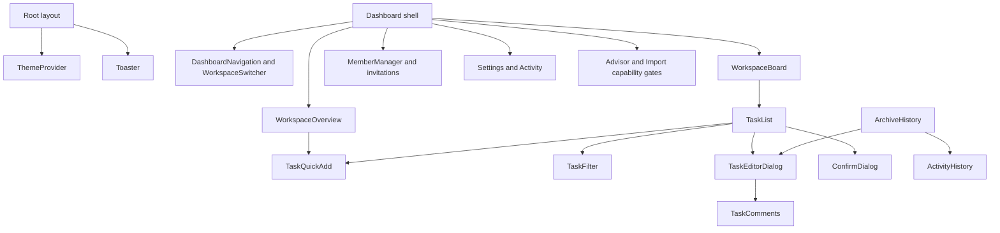

# Saathi UI component inventory

Date: 2026-10-06. Checkout: implementation, branch feature/saathi-interface-refresh. Source baseline: 9da6551.

This is a source-grounded inventory before the approved Compact B direction is implemented. No product code was changed. The ignored HTML prototype is a design reference, not the current React application. No browser acceptance, bundle measurement or accessibility conformance is claimed here.

## What exists and what is used

| Layer | Files | Reachable from current page/layout/loading imports | No current page path |
| --- | ---: | ---: | ---: |
| Product components | 26 | 24 | 2 |
| Shared UI files, including two hook copies | 56 | 14 | 42 |
| Total under components | 82 | 38 | 44 |

Reachable means there is a static import path from an App Router page/layout/loading entry. It does not mean every export is rendered, a feature flag is enabled, or browser behavior passed. A type-only import can overstate usage. The scan follows local imports in app, components, hooks and lib, excludes tests, and does not establish dynamic/external consumers. Caller tables include imports from dormant files; that alone does not make a component active. Each row inventories a file/family, not the number of React exports. Line totals are text lines, including whitespace: 9,333 in components, of which 5,467 have no current page path. Removing these files would reduce maintained source; it does not imply an equivalent bundle or performance reduction.

## Current screen and ownership map

| Surface | Entry and contents | Why it exists / ownership |
| --- | --- | --- |
| All pages | app/layout.tsx: ThemeProvider, Toaster, Analytics, globals.css | Shared theme, feedback and global styling; not workspace data ownership |
| Home / landing | app/page.tsx checks session, redirects or renders app/landing/page.tsx | Public product entry; landing header, hero, CTA and footer are inline |
| Login / register | AuthForm via the two auth pages | One shared identity form with mode-specific behavior |
| Forgot / reset password | PasswordRecoveryForm; reset page checks recovery state | Recovery journey with request/update modes |
| Auth failure | app/auth/error/page.tsx | Inline error explanation and navigation; logo and image |
| Dashboard guard | app/dashboard/layout.tsx | Server session gate plus inline service-unavailable/retry screen |
| Dashboard shell | app/dashboard/page.tsx | Client auth/capabilities, selected workspace, view/hash navigation, menus, dialogs, task-open request and mutation feedback |
| Overview | WorkspaceOverview plus TaskQuickAdd | What needs attention now; date/timezone grouping, completion and progress |
| Board | WorkspaceBoard -> TaskList | Paginated server filtering and deliberate task editing; three status columns |
| Team | MemberManager inside dashboard Card | Members, invitations and access management |
| Activity | ActivityHistory inside dashboard Card | Read-only change history; currently fetches when expanded |
| Settings | WorkspaceSettings | Owner metadata and lifecycle actions |
| Create workspace | WorkspaceCreateForm | First workspace and subsequent workspace creation; AI suggestion conditional |
| Ask Saathi | WorkspaceAdvisor in dashboard Dialog | Conditional assistance with reviewed proposals and explicit confirmation |
| Import | TaskImport in dashboard Dialog | Conditional CSV preview/import |
| Archive | app/archive/page.tsx -> ArchiveHistory | Retained workspace history and read-only task details; no restore action found |
| Invitation link | app/invitations/[id]/page.tsx -> InvitationResponse | Server invitation/account checks followed by accept control |
| Guide / help | app/guide/page.tsx, app/help/page.tsx | Inline static guidance/cards and navigation; guide accounts for AI availability |
| Legacy tasks URL | app/tasks/page.tsx | Redirect entry, not a separate task management UI |
| Loading | app/loading.tsx, app/dashboard/loading.tsx -> PageLoader | Route loading and accessible loading text |

The dashboard header, profile menu, workspace heading/menu, shortcuts dialog, realtime badge, service-error panels, Team/Activity/Board containers and optional AI/import dialogs are inline JSX, not independent files. They still count as UI responsibilities. Compact B must simplify these as well as the component folder.

## Component relationships

## Product components: use and reason

Paths below are relative to implementation. Direct callers identify ownership, not proof of rendered output.

| Component file | Current page path | Why it exists / responsibility | Direct callers |
| --- | --- | --- | --- |
| `components/activity-history.tsx` (61 lines) | Yes | Read-only workspace event timeline; owns expand, fetch, loading and error state. | `app/dashboard/page.tsx`, `components/archive-history.tsx` |
| `components/archive-history.tsx` (85 lines) | Yes | Browse archived workspaces and read archived tasks and activity; owns selection and fetch state. | `app/archive/page.tsx` |
| `components/assistant-workspace.tsx` (86 lines) | None found | Old assistant-first workspace shell with repeated metrics and Advisor; no current page path. | None |
| `components/auth-form.tsx` (234 lines) | Yes | Shared login/signup, Google entry, confirmation and inline errors; owns credentials and pending state. | `app/(auth)/login/page.tsx`, `app/(auth)/register/page.tsx` |
| `components/confirm-dialog.tsx` (53 lines) | Yes | Reusable destructive confirmation backed by Radix AlertDialog; takes controlled state and callbacks. | `components/member-manager.tsx`, `components/task-list.tsx` |
| `components/dashboard-navigation.tsx` (35 lines) | Yes | Overview, Board, Team navigation in desktop rail and mobile modes; controlled by dashboard. | `app/dashboard/page.tsx` |
| `components/invitation-notifications.tsx` (157 lines) | Yes | Pending invitation inbox with accept/decline and refresh feedback. | `app/dashboard/page.tsx` |
| `components/invitation-response.tsx` (24 lines) | Yes | Accept or decline an invitation from its dedicated link; pending and error feedback. | `app/invitations/[id]/page.tsx` |
| `components/member-manager.tsx` (275 lines) | Yes | Invite, remove, inspect invitation delivery and transfer ownership; role-aware controls and confirmation. | `app/dashboard/page.tsx` |
| `components/page-loader.tsx` (13 lines) | Yes | Shared named loading indicator using Spinner; no data ownership. | `app/dashboard/loading.tsx`, `app/dashboard/page.tsx`, `app/loading.tsx` |
| `components/password-recovery-form.tsx` (67 lines) | Yes | Request reset or set a password; confirmation, pending and inline errors. | `app/(auth)/forgot-password/page.tsx`, `app/(auth)/reset-password/page.tsx` |
| `components/saathi-logo-mark.tsx` (21 lines) | Yes | Image-backed reusable logo mark; display only. | `components/saathi-logo.tsx` |
| `components/saathi-logo.tsx` (24 lines) | Yes | Brand wrapper around SaathiLogoMark; display only. | `app/auth/error/page.tsx`, `app/dashboard/page.tsx`, `app/guide/page.tsx`, `app/help/page.tsx`, `app/invitations/[id]/page.tsx`, `app/landing/page.tsx`, `components/auth-form.tsx`, `components/password-recovery-form.tsx` |
| `components/task-comments.tsx` (170 lines) | Yes | Task discussion, cursor continuation, drafts, command identity and uncertain outcome recovery. | `components/task-list.tsx` |
| `components/task-filter.tsx` (106 lines) | Yes | Controlled search, active/completed status, priority and assignee controls; no independent fetching. | `components/task-list.tsx` |
| `components/task-import.tsx` (83 lines) | Yes | CSV file selection, parse/preview and confirmed import; capability-gated by dashboard. | `app/dashboard/page.tsx` |
| `components/task-list.tsx` (700 lines) | Yes | Board columns/cards, filters, quick add, editor, permissions and deletion confirmation; also exports archive detail editor. | `components/archive-history.tsx`, `components/workspace-board.tsx` |
| `components/task-quick-add.tsx` (98 lines) | Yes | Shared title-first creation with optional details; preserves draft and reconciles unknown outcomes. | `components/task-list.tsx`, `components/workspace-overview.tsx` |
| `components/theme-provider.tsx` (12 lines) | Yes | Thin next-themes provider; root config currently selects light theme with system selection disabled. | `app/layout.tsx` |
| `components/time-sensitive-greeting.tsx` (22 lines) | None found | Clock-aware greeting updated on focus/interval; no current page path. | None |
| `components/workspace-advisor.tsx` (138 lines) | Yes | AI question, response, reviewed draft and explicit confirmation; capability-gated in dashboard. | `app/dashboard/page.tsx`, `components/assistant-workspace.tsx` |
| `components/workspace-board.tsx` (77 lines) | Yes | Connects paginated Board hook to TaskList; detail lookup, versioned mutations and reload feedback. | `app/dashboard/page.tsx` |
| `components/workspace-create-form.tsx` (93 lines) | Yes | Manual workspace name/summary/date form; optional AI draft preview and approval when enabled. | `app/dashboard/page.tsx` |
| `components/workspace-overview.tsx` (128 lines) | Yes | Progress and date-based priorities with quick add, completion and link to Board; controlled task data. | `app/dashboard/page.tsx` |
| `components/workspace-settings.tsx` (65 lines) | Yes | Owner-facing workspace metadata, archive and permanent delete; local drafts and pending feedback. | `app/dashboard/page.tsx` |
| `components/workspace-switcher.tsx` (34 lines) | Yes | Controlled native workspace selection; optional create button, disabled by dashboard caller. | `app/dashboard/page.tsx` |

## Nested product components

| Parent file | Nested component | Responsibility |
| --- | --- | --- |
| auth-form.tsx | FieldShell | Label and field layout |
| auth-form.tsx | GoogleButton / GoogleMark | Google entry pending state and branded icon |
| workspace-overview.tsx | TaskSection / TaskRow | Group heading/empty state and permission-aware task completion/opening |
| task-list.tsx | TaskColumn | Status heading, count, list and empty state |
| task-list.tsx | TaskListItem | Task card, metadata and permitted actions |
| task-list.tsx | TaskEditorDialog | Shared details/edit modal; also used read-only by ArchiveHistory |

TaskList is about 700 text lines because it includes board orchestration and these nested components. Splitting it into files alone would not reduce logic. Change ownership only when it makes a specific behavior simpler to preserve and verify.

## Shared UI inventory

These are local shadcn-style families, not 56 product features. Radix supplies interaction primitives where used; native elements, CVA and cn supply much of the styling. Keep proven modal/menu/focus behavior when changing presentation.

| UI file | Purpose | Current page path | Direct callers |
| --- | --- | --- | --- |
| `components/ui/accordion.tsx` | Expandable disclosure groups | None found | None |
| `components/ui/alert-dialog.tsx` | Radix destructive confirmation composition | Yes | `components/confirm-dialog.tsx` |
| `components/ui/alert.tsx` | Styled inline alert/title/body | None found | None |
| `components/ui/aspect-ratio.tsx` | Radix fixed-ratio media container | None found | None |
| `components/ui/avatar.tsx` | Radix avatar/image/fallback | Yes | `app/dashboard/page.tsx` |
| `components/ui/badge.tsx` | Status/metadata label variants | Yes | `app/dashboard/page.tsx`, `app/guide/page.tsx`, `components/invitation-notifications.tsx`, `components/task-list.tsx`, `components/workspace-advisor.tsx` |
| `components/ui/breadcrumb.tsx` | Breadcrumb navigation composition | None found | None |
| `components/ui/button-group.tsx` | Grouped buttons | None found | None |
| `components/ui/button.tsx` | Shared action variants, sizes, focus styles and Slot composition | Yes | `app/dashboard/page.tsx`, `app/guide/page.tsx`, `app/help/page.tsx`, `app/landing/page.tsx`, `components/activity-history.tsx`, `components/archive-history.tsx`, `components/assistant-workspace.tsx`, `components/auth-form.tsx`, `components/invitation-notifications.tsx`, `components/invitation-response.tsx`, `components/member-manager.tsx`, `components/password-recovery-form.tsx`, `components/task-comments.tsx`, `components/task-filter.tsx`, `components/task-import.tsx`, `components/task-list.tsx`, `components/task-quick-add.tsx`, `components/ui/alert-dialog.tsx`, `components/ui/calendar.tsx`, `components/ui/carousel.tsx`, `components/ui/input-group.tsx`, `components/ui/pagination.tsx`, `components/ui/sidebar.tsx`, `components/workspace-advisor.tsx`, `components/workspace-board.tsx`, `components/workspace-create-form.tsx`, `components/workspace-overview.tsx`, `components/workspace-settings.tsx`, `components/workspace-switcher.tsx` |
| `components/ui/calendar.tsx` | react-day-picker styled date calendar | None found | None |
| `components/ui/card.tsx` | Surface/header/title/body composition | Yes | `app/dashboard/page.tsx`, `app/guide/page.tsx`, `app/help/page.tsx`, `components/assistant-workspace.tsx`, `components/invitation-notifications.tsx`, `components/task-list.tsx`, `components/workspace-advisor.tsx` |
| `components/ui/carousel.tsx` | Embla carousel controls | None found | None |
| `components/ui/chart.tsx` | Recharts styling, legend and tooltip helpers | None found | None |
| `components/ui/checkbox.tsx` | Radix checkbox | None found | None |
| `components/ui/collapsible.tsx` | Radix open/closed disclosure | None found | None |
| `components/ui/command.tsx` | cmdk command/search menu | None found | None |
| `components/ui/context-menu.tsx` | Radix right-click menu | None found | None |
| `components/ui/dialog.tsx` | Radix modal, overlay, title, description and close controls | Yes | `app/dashboard/page.tsx`, `components/task-list.tsx`, `components/ui/command.tsx` |
| `components/ui/drawer.tsx` | Vaul drawer | None found | None |
| `components/ui/dropdown-menu.tsx` | Radix action/profile menus | Yes | `app/dashboard/page.tsx` |
| `components/ui/empty.tsx` | Empty-state layout | None found | None |
| `components/ui/field.tsx` | Field/label/error layout | None found | None |
| `components/ui/form.tsx` | react-hook-form context and field helpers | None found | None |
| `components/ui/hover-card.tsx` | Radix hover preview | None found | None |
| `components/ui/input-group.tsx` | Input with attached adornments/actions | None found | None |
| `components/ui/input-otp.tsx` | OTP entry via input-otp | None found | None |
| `components/ui/input.tsx` | Styled native input | Yes | `components/auth-form.tsx`, `components/member-manager.tsx`, `components/password-recovery-form.tsx`, `components/task-filter.tsx`, `components/task-list.tsx`, `components/task-quick-add.tsx`, `components/ui/input-group.tsx`, `components/ui/sidebar.tsx`, `components/workspace-create-form.tsx`, `components/workspace-settings.tsx` |
| `components/ui/item.tsx` | Generic item/list composition | None found | None |
| `components/ui/kbd.tsx` | Keyboard shortcut styling | None found | None |
| `components/ui/label.tsx` | Radix label | Yes | `components/task-list.tsx`, `components/ui/field.tsx`, `components/ui/form.tsx` |
| `components/ui/menubar.tsx` | Radix desktop menu bar | None found | None |
| `components/ui/navigation-menu.tsx` | Radix website navigation | None found | None |
| `components/ui/pagination.tsx` | Numbered page navigation composition | None found | None |
| `components/ui/popover.tsx` | Radix anchored popup | None found | None |
| `components/ui/progress.tsx` | Radix progress indicator | Yes | `components/workspace-overview.tsx` |
| `components/ui/radio-group.tsx` | Radix radio inputs | None found | None |
| `components/ui/resizable.tsx` | react-resizable-panels wrappers | None found | None |
| `components/ui/scroll-area.tsx` | Radix styled scroll region | None found | None |
| `components/ui/select.tsx` | Radix select; current product uses native selects instead | None found | None |
| `components/ui/separator.tsx` | Radix separator | None found | `components/ui/button-group.tsx`, `components/ui/field.tsx`, `components/ui/item.tsx`, `components/ui/sidebar.tsx` |
| `components/ui/sheet.tsx` | Dialog-based side sheet | None found | `components/ui/sidebar.tsx` |
| `components/ui/sidebar.tsx` | Large generic sidebar/context/responsive state; current dashboard uses its own aside | None found | None |
| `components/ui/skeleton.tsx` | Loading placeholder | None found | `components/ui/sidebar.tsx` |
| `components/ui/slider.tsx` | Radix range slider | None found | None |
| `components/ui/spinner.tsx` | Shared animated loading icon | Yes | `components/page-loader.tsx` |
| `components/ui/switch.tsx` | Radix switch | None found | None |
| `components/ui/table.tsx` | Styled native table | None found | None |
| `components/ui/tabs.tsx` | Radix tabs | None found | None |
| `components/ui/textarea.tsx` | Styled native textarea | Yes | `components/task-comments.tsx`, `components/task-list.tsx`, `components/task-quick-add.tsx`, `components/ui/input-group.tsx`, `components/workspace-advisor.tsx`, `components/workspace-create-form.tsx`, `components/workspace-settings.tsx` |
| `components/ui/toast.tsx` | Radix notification primitives and visual variants | Yes | `components/ui/toaster.tsx`, `components/ui/use-toast.ts`, `hooks/use-toast.ts` |
| `components/ui/toaster.tsx` | Mounted root notification renderer using hooks/use-toast | Yes | `app/layout.tsx` |
| `components/ui/toggle-group.tsx` | Radix grouped toggle controls | None found | None |
| `components/ui/toggle.tsx` | Radix toggle button | None found | `components/ui/toggle-group.tsx` |
| `components/ui/tooltip.tsx` | Radix tooltip | None found | `components/ui/sidebar.tsx` |
| `components/ui/use-mobile.tsx` | Duplicate mobile-breakpoint hook | None found | None |
| `components/ui/use-toast.ts` | Separate unmounted toast-store copy; active store is hooks/use-toast | None found | None |

## State and data behind the UI

| Owner | What it owns | Boundary to retain |
| --- | --- | --- |
| Dashboard page | User, capabilities, active view, modal visibility, selected task request, quick-add/refresh signals | Presentation orchestration; must not become a second durable data store |
| hooks/use-workspaces.ts | Workspace selection/read lifecycle, Overview task projection, workspace/task/member mutations, realtime reconciliation | Dashboard passes loadTasks only for Overview; do not reintroduce full task reads on every Board view |
| hooks/use-task-board.ts | Board filters, task pages, aggregates, cursor, reload/load-more, stale response protection | Server filters and bounded pages; prevent results from a previous workspace/filter replacing current state |
| WorkspaceBoard | Detail task lookup and version-aware Board writes | Preserve expected versions, explicit reload and uncertain-outcome feedback |
| TaskList and task-draft helpers | Filters in nonpaged mode, selected editor, drafts, conflict handling and operations | Board and archived details share the editor; preserve read-only mode and draft recovery |
| TaskQuickAdd | Local draft, optional fields, pending guard and reconciliation | Do not clear a draft on failed/unknown creation or blindly retry a write |
| TaskComments | Local body draft, cursor, pending command identity and scope guards | Preserve duplicate prevention, draft preservation and archived read-only behavior |
| useRealtime / useSSE | Connection lifecycle, event revision and resynchronization triggers | Events signal reconciliation; database reads remain authoritative |
| usePermissions and task-permission | Client visibility of allowed actions | Server authorization remains mandatory; hidden buttons are not security enforcement |
| useNotifications -> hooks/use-toast -> Toaster | Shared feedback queue and variant mapping | One mounted toast store; inline errors remain near the failing action |
| hooks/useTaskStore.ts | Separate Zustand task/filter store | No current consumer found; not the active Board data owner |

## Styling and existing libraries

- Actual styling runs through app/globals.css, Tailwind utility classes and local UI variants. Dashboard-specific CSS variables establish its surface, brand, spacing and radii. Many auth/landing styles use literal colors and page-specific classes.
- lib/saathi-design.ts defines colors/assets, but no non-test production import was found. Its violet palette differs from the current dashboard teal variables. It is not the active token authority; do not build a new theme from it without reconciling the source of truth.
- Button defines 36px default, 32px small, 40px large and 36px icon sizing; dashboard also declares a 44px control token. Those are different sizing mechanisms. This is a consistency review item, not a claim that every control violates an accessibility rule.
- Existing reusable behavior includes Radix dialogs, alert dialogs, dropdown menus, avatar, progress and toast. Keep these; a compact design does not require a new component library.
- RHF is imported by the currently unreachable ui/form wrapper. The inspected live product forms use local React state/native form elements. Being installed does not mean RHF already manages the product forms.
- Native selects/date inputs already serve several filters/forms. Do not replace them merely to use an installed Radix select/calendar.
- Recharts and Embla are imported by unreachable chart/carousel files. Sonner and GSAP have no imports in the scanned production directories. Before removing dependencies, check all repository consumers, scripts/config and lockfile implications.

## Confirmed gaps and recommendations

These are proposals, not implemented changes.

| Finding | Source evidence | Smallest useful next step |
| --- | --- | --- |
| Two dormant product surfaces | AssistantWorkspace and TimeSensitiveGreeting have no caller | Review removal rather than redesigning or reviving them |
| 42 shared UI files have no page path | Import graph and exact caller table above | Remove only after whole-repo consumer check; preserve required primitive transitive dependencies |
| Duplicate toast hook | ui/use-toast has no caller; notifications and root renderer use hooks/use-toast | Retain one active store; review unused copy for removal |
| Duplicate mobile hook | hooks/use-mobile and ui/use-mobile are identical; only dormant generic sidebar imports the former | Prefer CSS for current responsive layout; remove redundant copy after consumer check |
| Dormant Zustand store | useTaskStore/useTasksWithRealtime have no external consumer found | Do not make it a third state owner during Compact B |
| Theme definition drift | Unimported saathi-design palette versus globals dashboard variables and literal page colors | Make existing CSS tokens the agreed authority before changing the compact presentation |
| Dashboard repeats workspace identity | Selector/header and workspace heading both show the workspace | Keep one clearly useful identity/context treatment |
| Activity repeats container/heading/expand behavior | Dashboard Activity Card wraps ActivityHistory's own heading and Show control | Activity page can show the record directly; archive may still need expandable history |
| Confirmation interaction differs | Task/member actions use ConfirmDialog; settings use window.confirm | If changing this area, reuse the existing confirmation family and preserve pending/error behavior |
| Overview row and Board card differ | TaskRow versus TaskListItem | Keep purposeful differences: fast completion versus full status/metadata; share only proven duplicate logic |
| Details are coupled to TaskList module | Archive imports TaskEditorDialog from task-list | Preserve reuse and archive permissions; extract only if a concrete ownership/bundle benefit warrants it |
| Unused dashboard mutation wrappers | handleEditTask and handleDeleteTask have definitions but no callers in the dashboard source | Review removal; Board owns its own versioned write/reload path |
| Manual fetch lifecycles exist in several areas | Board hook, comments, invitations, Activity, archive | Do not add a global library migration now; earlier Board trial remains evidence-gated |
| Shell responsibilities live in one large route | Dashboard page includes menus, guards, dialogs and mutation feedback | Compact the visual shell first; avoid a component for every small fragment |

## Compact B mapping and protected behavior

Keep Overview and Board as distinct jobs, visible navigation labels, the workspace selector, title-first creation, the existing details editor, Team, Activity, Settings and archives. Reduce shell width/spacing, repeated headings, nested surfaces and secondary control prominence. Defer advanced fields through the existing Add details behavior. Keep AI entry conditional on capabilities. No new task state store or UI package is needed to achieve the selected direction.

Protected behavior: server authorization, capability gates, view/hash consistency, workspace switching, version conflicts, draft preservation, unknown-write recovery, cursor continuation, authoritative totals, comments, invitation/account boundaries, archive read-only details, destructive confirmation, visible errors/loading, keyboard navigation and responsive layouts.

TaskQuickAdd is reused by Overview and Board, but each mounted instance has its own draft. Switching views unmounts the previous form; reuse does not imply a shared persistent draft. Incoming invitation notifications and invitation-link response share accept/decline behavior but serve different contexts; outgoing member invitations have a separate delivery/revoke lifecycle.

Before implementation, turn this map into an explicit keep/change/remove list, then change the shell and existing components in narrow slices. Verify the real current screens at desktop and mobile widths, keyboard/focus, empty/loading/error states, task creation/edit/completion, workspace switch, filters/load-more, Team/invitation and archived details. Source reachability is not browser acceptance. This inventory does not close the existing FRS/NFR release gates.

## Evidence and reproducibility

Static local import scan of app, components, hooks and lib, followed by source inspection of route composition, product behavior and shared feedback/token ownership. The ignored .local-test/ui-inventory.cjs and JSON contain the scan data. No tests/build were rerun because this change is documentation only; prior test results are not new verification for a future UI change. No deletions, commits, pushes or deployments performed in this inventory task.
