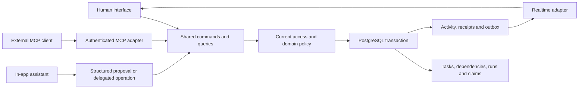

# Saathi: repository audit and agent coordination direction

Date: 2026-11-12. Status: proposed architecture and product design for review. This audit changes documentation only; it does not migrate data, move application files, install packages, deploy, or change permissions.

## Decision

Keep the existing Next.js/React/TypeScript application, Supabase Auth, and PostgreSQL. Reduce redundant code and give humans, the in-app assistant, and future external agents one shared application command/query boundary. Preserve the current realtime transport for the first agent-capable release. Evaluate replacing it as a separate measured change.

The product direction is shared coordination for people and agents: reliable task ownership, dependencies, execution claims, review, and a common history. Conversational input is one way to use this system. A personal chat-generated task list does not supply its shared authority or concurrency rules. This is the proposed product focus, not a claim of existing enterprise readiness.

## Scope and evidence

- Inventoried 672 unique tracked and nonignored untracked working-tree files before these audit artifacts were added. Ignored dependencies, builds, secrets, local fixtures, and Git internals are excluded.
- Classified all inventoried paths and built a TypeScript-AST import graph. Inspected the domain context, accepted ADR, schema and migrations, command/data boundaries, active realtime/client coordination, advisor contracts, dashboard components, verification scripts, and earlier architecture reviews.
- Revisited the live public landing page and guide. Inspected the November 11 production desktop/mobile acceptance screenshots and current signed-in UI source; no new signed-in browser session was created for this audit.
- Consulted current official documentation for Supabase Realtime, TanStack Query, Convex, and MCP. This is a structural/product audit, not a new penetration test, restore drill, load test, or production certification.
- The checkout already contains many changes and local artifacts from earlier work. They were preserved, including the user-owned design directory. Existing dirty files are not attributed to this audit.

The [inventory](2026-11-12-repository-inventory.json) records every path, category, size, and applicable static imports/reachability. Reachability is a review signal: type-only imports can overstate runtime use; migrations, config, tests, CSS, scripts, and dynamic consumers need separate review.

| Category | Files |
| --- | ---: |
| Application | 204 |
| Tests | 124 |
| Documentation | 148 |
| Generated output | 93 |
| Tooling | 23 |
| Migration files and journal | 12 |
| Assets | 32 |
| Configuration | 27 |
| User design files | 9 |

## Findings that affect the product direction

| Priority | Finding | Evidence and consequence | Recommendation |
| --- | --- | --- | --- |
| First | The assistant does not understand the readiness graph | `lib/ai/workspace-advisor.ts` projects task fields but no prerequisite edges or readiness facts. The service supports summaries, attention, and one draft. | Add a bounded, authorized coordination projection with prerequisite IDs, computed readiness, versions, and scoped actor references. Compute factual counts/readiness outside the model. |
| First | No external agent execution boundary | There is no MCP server route, delegated agent identity/grant, agent run, or task claim model in the current routes/schema. | Build thin authenticated tools over shared application commands; do not automate the browser or expose SQL/provider credentials. |
| First | Agent-safe retries cover only part of the command set | SQL receipts cover task creation, comments, and dependency changes. Status changes use version-checked edits/toggles without the same receipt contract. | Introduce explicit set-status commands with command IDs and versions before allowing agent execution. Never make a retryable agent tool toggle status. |
| First | Parallel coordination needs more than assigning a task | Assignment identifies responsibility; it does not establish which run currently holds an execution claim. | Use an atomic, expiring task claim with a fencing token when enabling parallel agents. Preserve conflict handling and current access checks. |
| First | Public explanation contradicts the primary workflow | The live guide says Today/Next/Completed while Overview now presents Ready and Waiting. The opening invitation glossary in CONTEXT also describes only the older addressed-invitation flow. | Reconcile guide, glossary, README, and capability contracts. Do not market an agent workflow before it exists. |
| Next | Generic coordination has multiple implementations | `hooks/useRealtime.ts` is active; `hooks/useSSE.ts` and `hooks/useTaskStore.ts` are not reached by the app scan. `lib/realtime-websocket.ts` is also dormant. | Confirm script/test/dynamic callers, then remove redundant paths in a separate cleanup change. Keep one active transport owner. |
| Next | UI responsibilities are concentrated | `components/task-list.tsx` is 830 text lines; `app/dashboard/page.tsx` is 537; `hooks/use-workspaces.ts` is 568. | Extract task details and dashboard shell responsibilities as feature slices change. Line count alone is not a reason to refactor. |
| Next | The repository has a large reference/output surface | 56 shared UI files, 14 statically app-reachable; 148 documentation files; 93 output artifacts. | Curate current entry points, separate historical evidence, and prune confirmed unused primitives/dependencies. This does not establish an equivalent bundle reduction. |
| Next | Configuration includes obsolete concepts | `.env.example` and `lib/env.ts` retain NextAuth/session settings although identity is Supabase-based; only the env module references those names in the scanned code. | Audit effective consumers and consolidate validated configuration. Remove unsupported settings and misleading setup advice only with compatibility checks. |
| Later | Large-organization scale is not established by the small-team benchmark | Graph reads load the complete workspace graph; task writes serialize on a workspace lock; the AI path reads all tasks. | Retain correctness now. Define larger datasets and contention targets before changing locks, projections, indexes, or tenancy. |

## How custom is the infrastructure?

The active transport/rate-limit/outbox/client-event files identified in the scan total roughly 2,000 text lines, including comments, the Redis mock, admission controls, and rate limiting. This is a maintenance footprint, not 2,000 unnecessary lines or a bundle-size measurement.

The custom responsibilities include Redis stream polling, retention/replay cursors, event normalization, stream admission leases, presence, membership batching, outbox publication, and browser reconnection/reconciliation. The important distinction is between generic delivery mechanics that a provider can own and domain obligations Saathi must retain: authorization, command identity, version checks, task/dependency invariants, and an attributable history.

## Stack alternatives

| Approach | Benefit | Cost or unresolved condition | Decision |
| --- | --- | --- | --- |
| Keep the current stack and simplify boundaries | Preserves the verified workflow and SQL invariants; lowest migration surface | Existing realtime infrastructure still needs an owner | Recommended for the first agent-capable release |
| Keep PostgreSQL/Auth; evaluate Supabase Broadcast and a standard query cache | Can delegate transport and parts of client data lifecycle | Broadcast permissions are connection-cached; membership revocation, reconnect, payload exposure, and recovery require an equivalent design | Separate bounded comparison, not a launch dependency |
| Replace persistence/backend coordination with Convex | Integrated reactive queries, transactional mutations, scheduling, and client synchronization | Recreates auth, data migration, graph constraints, command receipts, roles, fixtures, and acceptance evidence in a different backend model | Plausible greenfield choice; not justified for this checkout |
| Replace Next/React or add microservices | Could suit substantially different runtime needs | No measured problem here requires a new frontend framework or service boundary | Do not do now |

Supabase currently recommends Broadcast for scalable database-change delivery. Its authorization documentation states that channel access policy decisions are cached for a connection and membership removal does not immediately refresh those decisions. Saathi currently rechecks membership before event batches and periodically while idle. A naive switch would weaken that contract. A future comparison should consider payload-free invalidation plus authorized refetch, but topic leakage and revocation still need explicit acceptance. [Database-change options](https://supabase.com/docs/guides/realtime/subscribing-to-database-changes), [authorization behavior](https://supabase.com/docs/guides/realtime/authorization).

TanStack Query supplies fetching, caching, synchronization, and server-state updates. Pilot it on one bounded data surface; keep drafts separate, key caches by account/workspace/scope, and preserve unknown-outcome receipts and version conflicts. A library does not automatically solve those domain obligations. [Official overview](https://tanstack.com/query/latest/docs/framework/react/overview).

Convex offers reactive query subscriptions and transactional mutations; this makes it worth considering for a new build, but does not make a migration automatically cheaper. [Official architecture](https://docs.convex.dev/understanding/overview).

Keep the existing small provider adapter for now. Do not add an agent framework, queue, vector store, or orchestration platform simply because the interface becomes conversational. Use an official MCP SDK when exposing tools; use a maintained durable-job service only once execution must survive process restarts or wait on external systems.

## Database: retain, simplify, extend

The schema defines 12 application tables. They have distinct purposes:

- Product records: profiles, workspaces, memberships, invitations, tasks, dependencies, comments.
- Invitation mailbox proof: invitation_email_verifications, for the supported addressed-invitation compatibility flow.
- Reliability/observability: activity_events, outbox_events, command_receipts, ai_operation_logs.

Keep normalized task/dependency/member records, foreign keys, owner-membership consistency, optimistic versions, and transactional commands. Keep readiness derived from the graph rather than persisting another mutable status. Keep activity, outbox, and receipts separate: historical facts, pending delivery obligations, and command replay results have different retention and authorization rules. This is not event sourcing; current product tables remain authoritative.

Runtime data access is primarily Postgres.js tagged SQL; Drizzle owns schema/migration tooling. Do not rewrite functioning SQL just to make runtime ORM usage uniform. Keep the migration history and journal; do not squash applied production migrations. Current browser domain-table access is denied by RLS/grants, so managed browser subscriptions would require a deliberately reviewed access model.

Candidate simplifications, in order:

1. Stop producing legacy Today/Next buckets in new planning flows once the replacement semantics are agreed; assess consumers and old records before deprecating the column.
2. Use stable user IDs in new command/tool contracts. Email may remain a UI compatibility field; do not make agents impersonate a human or depend on mutable email identity.
3. Consolidate input/result contracts and environment validation. Keep policy and SQL mutations in one authority; adapters should translate transport, not duplicate permissions.
4. Measure full-graph reads and workspace-lock contention before adding indexes or narrowing locks. Do not replace relational records with generic JSON documents for cosmetic table-count reduction.
5. Define data retention explicitly. Do not delete unresolved receipts, unpublished outbox rows, or audit facts as generic cleanup.

For the proposed agent feature, add only the structures required by its accepted slice: delegated actor/grant information, agent runs, and atomic task claims. Human ownership and agent execution are separate concepts. Bind each run to its initiating human, workspace, allowed commands, expiry/revocation, and relevant task/version context. A first version may be on-behalf-of-human; broad organization service accounts are a later requirement. No schema change is implemented by this proposal.

Do not add organizations, portfolios, sprint planning, billing, RAG, a generic workflow engine, or a supervisor framework before real collaboration requires them. Keep workspace as the current authorization boundary.

## Recommended folder structure

Keep the root App Router arrangement; avoid a cosmetic migration to src or a monorepo. Introduce feature ownership incrementally:

```text
app/                         routes, layouts, thin action/API adapters
features/
  auth/                      identity UI and application contracts
  workspaces/                membership, invitations, settings, lifecycle
  tasks/                     task UI, contracts, queries and commands
  coordination/              readiness, agent tools, runs and claims
components/ui/               maintained accessible UI primitives
hooks/                       genuinely shared presentation hooks
lib/
  db/                        SQL connection and schema
  supabase/                  provider session integration
  realtime/                  one transport adapter and protocol helpers
  ai/                        provider adapter and validated projections
drizzle/                     existing reviewed migrations and journal
scripts/                     development, fixtures and verification tools
tests/e2e/                   rendered browser journeys
docs/
  product/                   current product scope and UX
  architecture/              current architecture and inventories
  adr/                       accepted decisions and their consequences
  operations/                setup, release, recovery and cleanup
  release/                   curated dated evidence
public/                      product assets
```

A feature owns its components, pure contracts, application operations, and related tests. The SQL transaction boundary remains singular; relocate existing modules only when their feature is changed and import boundaries are verified. Pure contracts must not import server actions or provider clients. Shared libraries must not depend on feature UI. Feature-to-feature operations go through explicit application contracts, not circular imports or direct component calls.

Do not create empty placeholder folders or a generic service/repository/use-case layer for every function. Retain existing import aliases as temporary compatibility adapters where needed. Update direct Node test paths and package commands in each move. Confirmed historical documents can move only with link redirects/index updates. Preserve the user design directory.

## Target command architecture



The MCP adapter exposes Saathi capabilities; connecting Saathi to other MCP servers is a different integration and is not required for the first release. MCP does not supply durable coordination, domain authorization, task claims, or a supervisor by itself. Use the maintained protocol/authorization mechanisms rather than designing a new token protocol. [MCP architecture](https://modelcontextprotocol.io/docs/learn/architecture), [HTTP authorization](https://modelcontextprotocol.io/specification/latest/basic/authorization).

The first agent contract should cover an authorized work-context read, task proposal/create, explicit task status update, comment/evidence publication, and claiming/releasing a task. Add dependency edits after the basic command lifecycle is proven. Every write carries a command ID, stable scope, expected version when appropriate, and actor attribution. Results distinguish committed, rejected, conflict, and unresolved; a transport failure never means the mutation rolled back.

Agents should execute in their existing client/runtime and use Saathi as the coordination authority. Hosting agent compute, writing a supervisor, or building a general tool-execution sandbox is not required for the first slice. The in-app model interprets intent and produces structured proposals; the shared command layer controls persistence.

For the first schema extension, prefer explicit agent_delegations, agent_runs, and task_claims records tied to existing human initiators and workspace memberships. Do not create fake Auth users for agents. Keep actor/run/grant attribution distinct from the current human actor foreign key, and enforce current human permissions plus the narrower grant at every operation. Client authorization uses a supported OAuth implementation with protected credential storage, not copied browser cookies or a homegrown token issuer.

Start with reviewed writes. Introduce limited unattended actions only under an explicit revocable grant. Never let a model grant membership, invent permissions, mark work successful without evidence, or run arbitrary shell/code through the task API. Resolving natural-language ambiguity is separate from execution authorization.

Run lifecycle: queued -> claimed/running -> awaiting review, succeeded, failed, or cancelled. A task claim expires and uses a fencing token so an old run cannot publish after reassignment. Cancellation is a request; only confirmed worker termination or fencing prevents further effects. Execution results and review decisions remain visible to humans. Tool calls alone are not proof that work was done. In the first reviewed workflow, an agent reports evidence and requests review; run state can be awaiting review while the task remains in progress. A human approval performs the explicit version-checked completion. Claims govern agent execution rather than blocking all human edits; changed task versions require reconciliation.

## Current UX assessment

The current dashboard already has three primary destinations: Overview, Board, and Team. The main issue is how responsibilities are distributed, not simply tab count. Ready and Waiting sits inside an Overview wrapper alongside quick-add and detailed prerequisite inspection; opening a task switches to Board. The assistant lives in a separate dialog. Desktop/mobile acceptance screenshots show repeated container controls and long email identity strings occupying useful space.

Keep the restrained visual system, clear permission-aware controls, responsive layouts, keyboard focus, draft recovery, and explicit error handling. Simplify information hierarchy, identity display, task opening, and the relation between a request and its resulting work. A conversational UI should produce inspectable task/run records, not hide all structure in a chat transcript.

## Proposed UI after architecture agreement

Three primary destinations, plus settings and a workspace selector:

| Destination | Primary question | Contents |
| --- | --- | --- |
| Work | What needs my action now? | Ready, Waiting, pending reviews; current-workspace Mine/Team filters; direct task completion and detail drawer |
| Plan | What outcome are we working toward? | Shared outcome, task list, dependencies and assignments; existing Board as an optional view rather than another product mode |
| Activity | What changed or ran? | Human/agent changes, run progress, evidence, failed operations, cancellation and retry/review actions |

Settings contains team/access, workspace configuration and integrations with role-appropriate visibility. Account settings stay in the profile menu. Portfolio is deferred until cross-workspace planning is an observed need.

Use one persistent request composer with text input first and an accessible optional voice input later. Examples of intended behavior: “What can I do next?” returns computed ready work; “Plan this release” yields a structured proposal; “Update these tasks” yields a visible change set with affected records and required review. Submit a reviewed action through the same commands as manual controls. Do not require a model call for simple counts, filters, or deterministic readiness.

Open task details in a shared drawer or mobile full-screen detail route without jumping to Board. Use stable deep links and retain the selected task on reload. Show people by display name with email available where needed for disambiguation/access decisions. Agent activity shows delegation, task, status, and evidence rather than a decorative autonomous avatar.

Adapt by revealing relevant structured content: an ambiguity question, proposal diff, review card, running task, or recovery action. Keep navigation, labels, keyboard behavior, and task identity stable. Avoid an interface that rearranges itself unpredictably. Manual editing must remain fully usable when the model is unavailable.

```text
Workspace selector                              Profile
Work                 Plan                 Activity

Ready                         Waiting
Task / owner / next action    Task / blocker / owner

Needs review
Proposed change / evidence / approve or revise

Request composer
Describe work or ask about this workspace ...
```

This is an information architecture proposal, not a finished visual mockup or an implemented interface. Product copy should explain real choices only; preserve accessible names, validation, recovery guidance, and destructive-action consequences.

## Execution order and exit gates

| Stage | Work | Exit gate |
| --- | --- | --- |
| 1. Freeze the direction | Review this proposal; choose the retained stack, feature boundaries, and first delegated workflow | One agreed scope and accepted decision record; no competing current plan |
| 2. Simplify the existing repo | Remove confirmed dormant paths; reconcile config/docs; extract shared contracts and task details | Existing functional/database/browser gates pass; fewer owners and no changed permissions |
| 3. Build the shared coordination slice | Add explicit idempotent status command, authorized graph projection, delegation/run/claim model, and thin agent adapter | Human and two independent agent clients use the same records; duplicate claims, stale runs, retries and revocation behave correctly |
| 4. Implement the simplified UI | Work/Plan/Activity, shared details, persistent composer, structured review and evidence | Main workflow completes by keyboard/mobile with model unavailable as well as available |
| 5. Release and learn | Re-run relevant live acceptance, clean exact fixtures, document release/recovery, pilot with real teams | No blocking defects; newcomers complete the workflow without coaching; observed team-use friction is addressed |

Do not make a backend replacement, agent framework migration, voice infrastructure, or enterprise feature parity a dependency of these stages. If a library pilot fails to delete meaningful custom complexity while retaining behavior, stop it and retain the current implementation.

Verification for the new slice must include: current owner/member/outsider boundaries; existing Ready/Waiting semantics; dependency cycle protection; task/edit conflicts; same-command lost-response recovery; two agents claiming the same task; lease expiry and stale fencing; revoked delegation and removed membership; cancelled or failed runs; proposal approval against changed versions; model-disabled/manual fallback; draft and account-scope isolation; responsive keyboard and accessibility behavior.

Existing performance evidence is revision-specific. Re-run the established 100-user/1,000-write/15-minute gate if execution or transport changes affect the workload. Do not substitute a new lighter test or describe this documentation audit as a fresh performance pass.

## What this hour can finish

This audit and proposed architecture/UI plan can be delivered within the requested planning hour. Implementing migrations, an authenticated agent API, parallel execution semantics, and a redesigned interface is separate engineering work requiring acceptance testing. A reliable duration estimate follows agreement on the first slice; the hour is not a promise to ship all of it.

Recommended first demonstrable outcome: a human describes a small shared outcome; Saathi proposes concrete tasks; an approved task is claimed by an authorized agent; another agent cannot accidentally claim the same execution; a person sees progress and evidence; a prerequisite completion unblocks the next task; failures and retries remain understandable. This makes the new approach tangible without rebuilding Jira.
