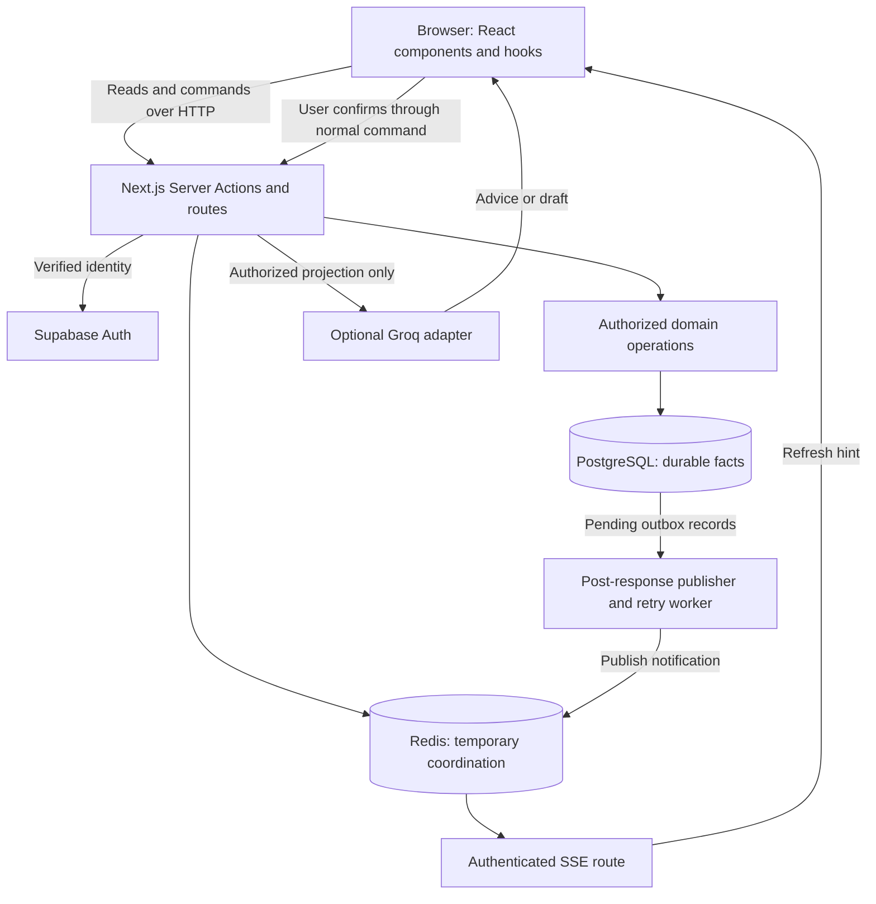
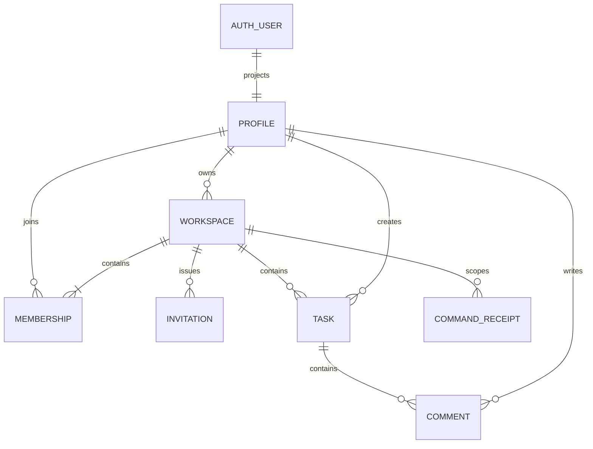

# 1. Architecture and data

[Handbook](README.md) · [Next: commands](02-commands-and-correctness.md)

## The system in one diagram

This is a modular monolith: one Next.js application with separated responsibilities. External Auth, PostgreSQL and Redis are dependencies, not evidence that we built microservices. Invitations use the application's inbox and copyable links; Supabase Auth owns account verification and recovery. Splitting deployments would add distributed authorization, deployment coordination, and network failure boundaries; we have no measured requirement for that change.

## Who owns a fact?

| Fact | Authority | A tempting but incorrect substitute |
| --- | --- | --- |
| Signed-in identity | Supabase server verification | Browser email, local storage, or user-editable metadata |
| Current membership | PostgreSQL `workspace_members` | An old member list or an open SSE connection |
| Task state | PostgreSQL `tasks` | Optimistic React state or a Redis event |
| Command already committed | PostgreSQL `command_receipts` when ID supplied | A disabled button or short-lived Redis claim |
| Notification awaiting delivery | PostgreSQL `outbox_events` | Process memory |
| Presence | Redis TTL state | Membership or proof of human activity |
| AI advice | A validated provider response | Permission, truth, or proof of persistence |

**Worked example:** Bob sees T marked done in his browser. That may be an optimistic update. To establish the durable fact, follow the command response or read PostgreSQL through an authorized operation. A “Live” badge establishes transport state, not transaction success.

## File boundaries

| Boundary | Example source | Responsibility |
| --- | --- | --- |
| Presentation | [dashboard](../../app/dashboard/page.tsx), [TaskList](../../components/task-list.tsx) | Render, collect input, display outcomes |
| Client coordination | [useWorkspaces](../../hooks/use-workspaces.ts), [useRealtime](../../hooks/useRealtime.ts) | Selection, async state, notifications, reconciliation |
| Application entry | [task actions](../../app/tasks/actions.ts), [workspace actions](../../app/actions/workspaces.ts) | Authenticate, apply admission controls, call domain operations |
| Domain/persistence | [tasks](../../lib/data/tasks.ts), [workspaces](../../lib/data/workspaces.ts) | Current authorization, invariants, locks, transactions |
| Shared rules | [task contract](../../lib/task-contract.ts), [permissions](../../lib/task-permission.ts) | Deterministic input and policy logic |
| Schema | [schema](../../lib/db/schema.ts), [migrations](../../drizzle/meta/_journal.json) | Durable relationships and constraints |

Drizzle defines schema/migrations. Domain queries largely use parameterized `postgres` tagged templates directly. Do not describe every data operation as an ORM query. TypeScript checks developer-facing shapes; runtime validation checks actual network input.

## Logical relationships

This is a logical relationship diagram, not a claim that every association is a SQL foreign key. Activity and outbox retain `workspace_id` without a workspace FK so deletion can preserve its audit fact and delivery obligation. Their future retention policy is a separate decision.

## Schema as executable requirements

| Invariant | Enforcement | Why it matters |
| --- | --- | --- |
| One membership per user/workspace | Composite primary key | Retry cannot duplicate the relationship |
| Owner must be a member | Deferred composite FK from workspace to membership | Ownership cannot point outside the workspace |
| Assignee belongs to the task's workspace | Composite FK to membership | Prevents cross-workspace assignment |
| One pending invite per normalized email/workspace | Partial unique index | Terminal invitations do not prevent a later new invite |
| Valid title/status/priority/estimate | Validation plus DB checks | Stored facts survive a buggy caller |
| Date-only and instant deadline are mutually exclusive | `task_deadline_exclusive` check | Prevents conflicting interpretations of due time |

Owner is `workspaces.owner_user_id`. Displayed membership roles are derived, not a second stored ownership authority. The deferred FK permits inserting workspace and owner membership within one transaction; it checks the final relationship at commit.

## Reads, indexes, and deletion

Read operations use repeatable-read transactions where membership and returned rows need one consistent snapshot. This does not mean a transaction sees membership changes made after its snapshot began. Writes lock current workspace state before proceeding.

Workspace listing uses two statements for a nonempty result: authorized workspace rows, then all relevant members. Task listing uses membership plus a joined projection. Reducing N+1 queries reduces work amplification; it does not establish a latency SLA.

Index choices follow query paths: membership lookup by user, tasks by workspace/time, comments by task/time, pending outbox rows, activity by workspace/time. Indexes cost storage and mutation work; add them after inspecting the query plan and realistic row counts.

Archive preserves records and permits current-member historical reads while blocking normal writes. Current code rejects permanent deletion of an archived workspace. Deleting an active workspace cascades its dependent tasks, comments, memberships, invitations, and receipts; activity and outbox are retained. Task deletion removes comments but leaves the workspace-scoped task command receipt, preventing a late retry from recreating that task.

## Check your understanding

**Question:** Why not store members inside workspace JSON? **Answer:** uniqueness, assignment references, concurrent membership changes, and authorization queries become application-managed problems. The accepted [PostgreSQL ADR](../adr/0001-postgres-source-of-truth.md) explains this tradeoff.

**Question:** Can the UI owner badge authorize deletion? **Answer:** no. The server derives the actor from Auth and checks current ownership inside the database operation.
