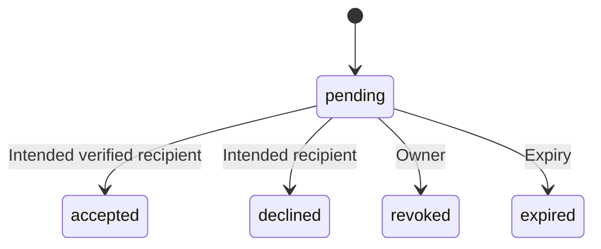

# 2. Commands and correctness

[Handbook](README.md) · [Previous](01-architecture-and-data.md) · [Next](03-realtime-and-client-state.md)

## Trace a task create

| Step | Symbol to inspect | What must be true |
| --- | --- | --- |
| Collect draft | `TaskList` / `WorkspaceOverview` | UI input is untrusted until server validation |
| Coordinate submission | `handleAddTask` in [useWorkspaces](../../hooks/use-workspaces.ts) | Retain the same command ID for an uncertain retry |
| Enter server | `addTask`, `actor` in [actions](../../app/tasks/actions.ts) | Verified session and task rate limit |
| Normalize | `normalizeTaskUpdates` in [contract](../../lib/task-contract.ts) | Allowed fields and valid values |
| Begin transaction | `createTaskRecord` in [tasks](../../lib/data/tasks.ts) | Workspace lock, membership, active workspace |
| Resolve retry | `readCommandReceipt` | Current authorization precedes receipt replay |
| Persist | Task + activity + outbox + optional receipt | All commit or all roll back |
| Complete response | `afterDomainCommit` in [post-commit](../../lib/post-commit.ts) | Cache/delivery failure cannot reverse successful persistence |
| Update view | Hook state update and later refresh | Database result replaces optimistic assumptions |

Server Actions are network-facing application entry points. They are not an in-process trust shortcut because the call syntax resembles a function.

```mermaid
sequenceDiagram
  participant B as Browser
  participant A as Server action
  participant D as Domain operation
  participant P as PostgreSQL
  B->>A: Input and stable command ID
  A->>A: Verify identity and admission
  A->>D: Actor UUID and input
  D->>P: BEGIN; lock workspace; check membership
  D->>P: Read receipt
  alt Already committed, matching request
    P-->>D: Original response snapshot
  else New command
    D->>P: Insert entity, activity, outbox, receipt
  end
  D->>P: COMMIT
  D-->>A: Durable result
  A-->>B: Success
  Note over A: Schedule notification delivery after response
```

## Three outcomes, not two

| Outcome | Example | Correct client behavior |
| --- | --- | --- |
| Rejected | Invalid title, denied access, stale version | Preserve useful draft; correct input or refresh |
| Committed | Transaction returns created task | Show success even if cache invalidation fails |
| Unknown | Connection lost around database acknowledgement | Reconcile; reuse stable command ID rather than blindly create |

The public task result currently uses optional `success`, `error`, `task`, `code`, `retryAfterSeconds`, and `unknownOutcome`. It is not a fully discriminated TypeScript union. Do not document a cleaner proposed union as already implemented. Unexpected errors are sanitized; raw database/provider details are not sent to users.

## Worked stale-edit race

1. Alice and Bob open task version 7.
2. Alice submits `expectedVersion=7`. The transaction locks workspace, then task, checks action permission, and saves version 8.
3. Bob submits his original draft with `expectedVersion=7`.
4. `matchesTaskVersion` rejects it against version 8. Bob must refresh and review the newer task.

**Locks** coordinate simultaneous transactions. **Versions** reject stale user intent. Neither replaces the other. The legacy timestamp expectation is also supported; integer versions are the clearer current contract. An omitted version is not an unconditional overwrite permission.

The workspace-first lock order is also used for task comments and membership changes. Consistent ordering reduces deadlock risk. Workspace locking deliberately serializes writes in a workspace: simple correctness now, a potential hotspot under heavy contention later. We have not established that each workspace supports unlimited concurrent mutation throughput.

## Lost acknowledgement and durable receipts

[Command receipts](../../lib/data/command-receipts.ts) use `(workspace_id, actor_user_id, command_id)` as the primary key. The receipt stores command type, normalized-request hash, and committed response snapshot. SHA-256 here detects reused command identifiers with changed inputs; it is not authentication or encryption.

Suppose create command C commits task X, but the reply is lost. A retry of C with the same request returns X's receipt and does not append a second create event. Reusing C for a different request is rejected. The workspace lock serializes concurrent attempts within that workspace.

Receipt replay is historical acknowledgement, not a current-state projection. If X was later deleted, replaying C returns its original acknowledgement without recreating X. Removed users still fail current authorization. Comment retries also require the task to remain accessible.

**Limit:** IDs are optional at the data/action boundary. Callers omitting them do not obtain create deduplication. Task/comment client IDs survive their current hook/composer lifetime, not an arbitrary full browser reload. Reconcile after losing that state. A new intentional create needs a new ID.

## CSV is a series of commands

[CSV import](../../app/actions/migration.ts) validates file size, row count, membership, feature availability, and row fields. It runs row creates sequentially; the entire file is not one atomic transaction. A partial success is a valid outcome.

Row command IDs derive from actor, workspace, exact file content, and row index. Identical rows at different indexes remain separate tasks. Retrying the exact file replays committed rows; changing file content constitutes a new import and may recreate unchanged logical rows. “Imported” counts successful row command outcomes, which can include receipt replays; it is not necessarily a count of newly inserted rows.

A failed Board refresh after a successful import is a view-refresh warning, not a failed import. Do not tell the user that persisted rows vanished.

## Membership changes and invitation state



In [respondToInvitation](../../lib/data/invitations.ts), acceptance verifies recipient, expiry, state, and workspace availability. Membership and terminal invitation state commit with activity/outbox. Repeated acceptance must not duplicate membership or events.

In [removeWorkspaceMember](../../lib/data/workspaces.ts), the owner may remove another member; a member may leave themself. The owner must transfer ownership before leaving. Assignments are cleared and task versions incremented before membership is removed, satisfying the assignment FK. Current code clears all matching assignments, including completed tasks; the older product phrase “open tasks” is narrower than implementation.

## Exercise

Bob retries C after Alice removes him. What should happen? **Answer:** reject current access before reading the receipt. Idempotency does not grant permanent permission. To verify, inspect [create-retry tests](../../lib/data/create-retry.test.ts), then identify which separate member-removal test exercises revocation.
