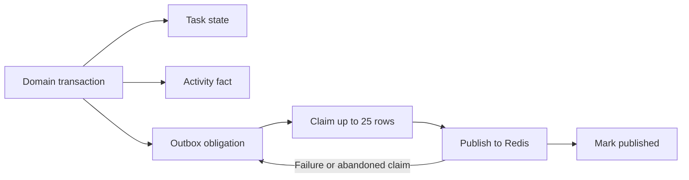
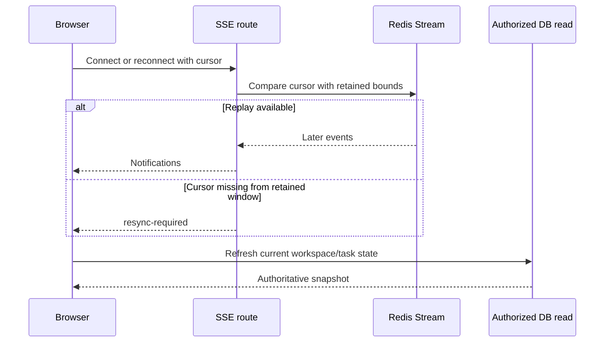

# 3. Realtime and client state

[Handbook](README.md) · [Previous](02-commands-and-correctness.md) · [Next](04-contracts-and-ai.md)

## Why the outbox exists

Saving a task and sending a Redis notification are writes to separate systems. PostgreSQL cannot atomically commit an ordinary Redis REST request. “Save, then publish” loses notifications on a crash; “publish, then save” can announce nonexistent state.

The [outbox](../../lib/data/events.ts) places the delivery obligation in the same PostgreSQL transaction as the domain write. `afterDomainCommit` schedules best-effort delivery through Next `after`; the authenticated [worker](../../app/api/internal/outbox/route.ts) retries durable pending work.

`FOR UPDATE SKIP LOCKED` lets publishers claim different pending rows. Claim tokens protect completion updates; claims older than five minutes are eligible again. The callback handles at most four batches of 25, while larger/failed backlogs need the worker. Process-local scheduling deduplication is an optimization, not durability or a global queue.

**Crash exercise:** Redis accepted event E, then the publisher died before marking it published. E may be published again. Therefore delivery is at least once; exactly once is not promised. Event deduplication and authoritative reads absorb duplicates. Even claims can expire while a slow publisher is still running.

## SSE transport

The browser's `EventSource` connects to `GET /api/realtime?workspaceId=...`. Writes continue through Server Actions. SSE is appropriate for one-way change notifications; WebSockets would not eliminate authorization, reconciliation, or delivery failure problems.

| Mechanism | Current purpose |
| --- | --- |
| Session and membership check | Admit only an authorized connection |
| Redis Stream cursor | Read after the last observed stream ID |
| 500 ms polling, batch up to 50 | Bounded read work; latency includes more than poll interval |
| Single-flight polling | Avoid overlapping reads within a connection |
| Five-second idle membership check | Detect idle revocation, excluding storage/runtime delays |
| Recheck before event batches/heartbeat | Do not rely on a completed cached decision to authorize delivery |
| 30-second heartbeat | Maintain presence and report connection information |
| Four-minute connection duration | Reconnect before the route's stated runtime budget |
| Retained-stream bounds check | Request resync when replay cannot be completed |

Authorization and delivery are not one database transaction. A membership check cannot make revocation and a later network write instantaneous or eliminate every check-to-send race. Document the checks and measured revocation latency rather than promise zero leakage latency.

Symbols: [GET and pollForEvents](../../app/api/realtime/route.ts), [cursor helpers](../../lib/realtime-sse.ts), [Redis stream adapter](../../lib/redis-streams.ts), [membership verifier](../../lib/sse-authorization.ts).

## Connection admission is shared state

Per-user connection leases use a Redis sorted set and an atomic Lua operation. It removes expired leases, checks the cap, and inserts the new lease using Redis time. Retrying one lease ID does not take another slot; release removes only that lease. In-process counters would fail when requests land on different application instances.

Profile and membership reads coalesce only concurrent reads with the same scope. Completed values are discarded. This saves duplicate work without treating a cached identity or permission decision as valid forever.

Rate limits use fixed time buckets and hashed scopes. Fixed windows can permit a burst around a boundary; they are not smooth traffic shaping. Attempt rate limiting and active-connection admission solve different problems. Read [rate-limit.ts](../../lib/rate-limit.ts), [sse-connection.ts](../../lib/sse-connection.ts), and [profiles.ts](../../lib/data/profiles.ts).

## Reconnection and convergence

Redis retains a bounded stream, not every historical change. A freshly opened empty stream must deliver its first event rather than confuse `0-0` with an expired reconnect cursor. Existing [poll-cost regressions](../../app/api/realtime/poll-cost.test.cjs) exercise this edge case.

Presence is TTL-based and approximate. A connected tab is not proof of current membership or active human attention. Activity history is a different PostgreSQL read model.

## Client races are a separate consistency problem

Read A starts, read B starts, B returns newer data, A returns older data. Both responses can be successful while blindly applying A produces a stale screen.

[useWorkspaces](../../hooks/use-workspaces.ts) coordinates read generations and selection identity. Only a current generation for the current selection may replace the view. An A→B→A navigation creates a new selection identity, so an old response for A remains stale. State updates also invalidate older task reads.

[createCoalescedRefresh](../../lib/read-coordinator.ts) shares in-flight work and retains a trailing refresh when more events arrive. Sustained events can keep the loop busy; this bounds concurrent duplication, not total refresh work forever. Task events refresh tasks; workspace/membership events and reconnects reconcile broader workspace state.

Optimistic task mutations give immediate feedback. On command failure, the hook attempts an authoritative refresh and may restore a previous view if that fails. A restored UI is not evidence that an uncertain server command rolled back.

## Exercise

Why refresh on reconnect even with a replayable cursor? **Answer:** reconnect is an opportunity to reconcile current facts, including permission changes and missed view updates. The notification log is a delivery aid, not the entire business database. Inspect [useRealtime](../../hooks/useRealtime.ts) and [workspace-sync tests](../../hooks/workspace-sync.test.cjs).
