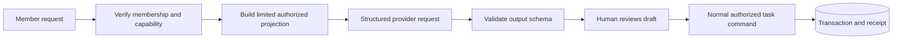

# 4. Contracts and AI boundaries

[Handbook](README.md) · [Previous](03-realtime-and-client-state.md) · [Next](05-requirements-and-operations.md)

## Read this as a contract catalogue

Signatures below are condensed for learning, not a generated OpenAPI description. The linked symbol owns the exact optional parameters and result type. Server Actions use framework-managed RPC; do not invent a REST URL for each one.

| Entry point | Input and output | Permission / failure rule | Source |
| --- | --- | --- | --- |
| `addTask` | Workspace, title/planning fields, optional command UUID → mutation result | Member; active workspace; duplicate-safe only with retained ID | [Task actions](../../app/tasks/actions.ts) |
| `updateTask` | Task, partial updates, expected version/timestamp → task or error | Owner/creator; version conflict rejects stale intent | [Task actions](../../app/tasks/actions.ts) |
| `toggleTask` | Task, expected version → changed task | Owner/creator/assignee | [Task actions](../../app/tasks/actions.ts) |
| `deleteTask` | Task, expected version → success/error | Owner/creator; task comments cascade | [Task actions](../../app/tasks/actions.ts) |
| `getTasks` | Workspace → full task collection/error | Current member; currently unpaged | [Task actions](../../app/tasks/actions.ts) |
| `getTaskComments` | Task, optional cursor → comments, nextCursor/error | Member; archived reads permitted | [Comment actions](../../app/actions/comments.ts) |
| `addTaskComment` | Task, body, optional command UUID → comment/error | Member; active workspace | [Comment actions](../../app/actions/comments.ts) |
| Workspace lifecycle actions | Name/details, IDs, expected versions where required → workspace/void/error | Create as authenticated user; management as owner | [Workspace actions](../../app/actions/workspaces.ts) |
| Invitation actions | Workspace/email or invitation ID → invitation/result | Owner sends/manages; intended recipient accepts/declines | [Invitation actions](../../app/actions/invitations.ts) |
| `importTasksFromCsv` | Workspace, exact CSV text → row outcome summary/error | Member, capability flag, byte/row bounds | [Import](../../app/actions/migration.ts) |
| `GET /api/realtime` | Workspace query + session + optional Last-Event-ID → SSE | Auth/member; connection and attempt admission | [Realtime route](../../app/api/realtime/route.ts) |
| `GET /api/usage` | Workspace query → cumulative usage JSON | Auth/member; private, no-store | [Usage route](../../app/api/usage/route.ts) |
| `POST /api/internal/outbox` | Bearer worker secret → delivery/cleanup outcome | Operator-only; missing configuration or degraded work fails explicitly | [Worker](../../app/api/internal/outbox/route.ts) |
| `POST /api/webhooks/email` | Provider payload/signature → processing result | Verify provider signature, not workspace user session | [Webhook](../../app/api/webhooks/email/route.ts) |

Auth callback, login, reset, registration and logout live in [auth-simple](../../lib/auth-simple.ts), [callback](../../app/auth/callback/route.ts), and [proxy](../../proxy.ts). The proxy guards dashboard routing; each resource entry still enforces its own identity and permission.

## Read shapes are deliberate projections

Database rows use UUID relations and `in_progress`; the public task shape maps emails for display and `in-progress` for the UI. `completed` is derived from status, not a separate competing database boolean. `version` carries concurrency intent. A display email does not replace actor UUID authorization.

Partial updates distinguish missing fields from explicit removal. Inspect `normalizeTaskUpdates` and own-property checks before changing a clear/unassign operation. Serializing optional values carelessly can silently drop intent.

`dueDate` is a calendar commitment; `dueAt` is an instant. They are mutually exclusive. Workspace IANA timezone governs rendering. Neither priority nor a UI execution bucket is a deadline or persisted blocked status.

## Pagination contracts

Comment reads return the newest page in chronological display order. Default page size is 50; the data function accepts at most 100. A cursor identifies a stored comment boundary scoped to the authorized task. SQL compares `(created_at, id)` using stored timestamp precision and fetches one extra row to detect continuation. The UI prepends older pages and deduplicates IDs.

Task Board search/filter/Overview totals still use the complete task collection. Activity reads return a bounded latest window without full continuation. A silent task `LIMIT` would make searches and totals false. Follow the staged [pagination plan](../architecture/2026-10-04-pagination-retention.md) before changing these contracts.

Usage is cumulative activity-derived counts: completed transitions, not the number of currently done tasks. Complete→reopen→complete can count twice. See [getWorkspaceUsage](../../lib/usage.ts).

## AI follows the same trust boundary

| Capability | Output | Mutation? |
| --- | --- | --- |
| `summarize_workspace` | Advisory answer | No |
| `identify_attention` | Reasons associated with task IDs | No |
| `draft_task` | Typed task proposal | Only after human confirmation through deterministic validation |

The [projection](../../lib/ai/workspace-advisor.ts) includes workspace name/summary and task IDs, titles, descriptions, status, priority, and due fields. Descriptions can contain sensitive information; “limited” does not mean anonymized. No raw prompt/output persistence by default also does not mean content never leaves the server: the selected provider receives this projection.

[requestWorkspaceAdvisor](../../lib/ai/workspace-advisor-service.ts) validates input and requests a strict schema. The [Groq adapter](../../lib/groq-chat.ts) uses a server-only credential, configurable model, and abort timeout. Schema validation proves shape, not factual grounding, valid authorization, or resistance to every prompt injection. A task ID emitted by a model still needs safe interpretation by the consumer.

`confirmWorkspaceAdvisorDraft` validates the proposal and re-enters `createTaskRecord`. The advisor retains one command ID for a proposal across retries. Durable command receipts protect the committed create and recheck current membership and archive state before replay; no Redis task snapshot bypasses that authorization. Workspace intent planning is a separate [service](../../lib/workspace-intent-service.ts) and [confirmation action](../../app/actions/workspace-intent.ts), not an autonomous agent with database tools.

AI logs retain operational metadata, not raw conversation history. Current advisor calls pass zero estimated cost: do not present this as real token billing. Exact counts, permission decisions, deadline checks, and retry outcomes remain deterministic code.

## Feature flags and stale clients

[resolveFeatureFlags](../../lib/feature-flags.ts) resolves environment controls for AI and CSV. [getFeatureCapabilities](../../app/actions/capabilities.ts) informs rendering; server actions independently enforce availability. These are environment switches, not percentage rollout, per-workspace entitlements, or a remote configuration platform.

**Exercise:** A browser has an old enabled AI button after the operator disables AI. Does hiding the button later solve safety? **Answer:** no; the action must reject the now-disabled capability regardless of client rendering. The core manual path remains usable without AI.
