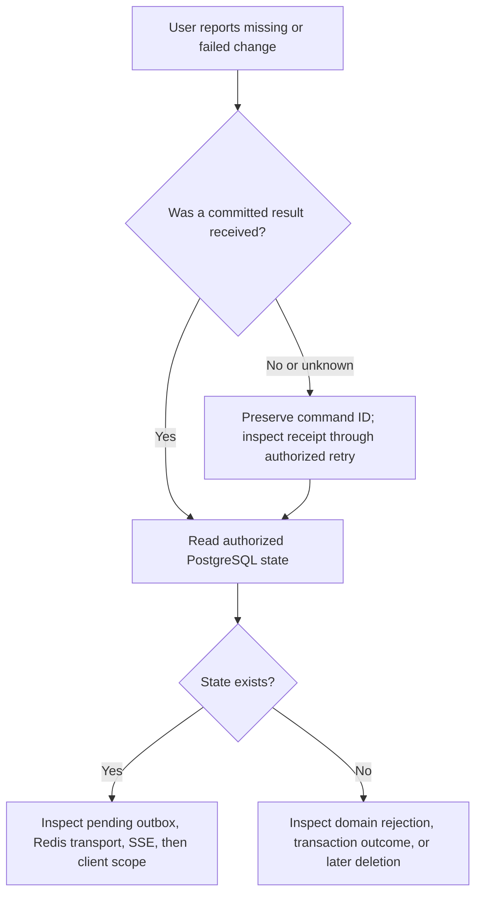

# 5. Requirements, evidence, and operations

[Handbook](README.md) · [Previous](04-contracts-and-ai.md) · [Next](06-mastery-lab.md)

## Status vocabulary

**Implemented** means current source contains the behavior. **Recorded verification** means a named, dated execution checked a stated boundary. **Planned** means a requirement remains unimplemented. **Deployment gate** means configuration or external acceptance remains necessary. Reading source in this documentation task does not rerun any test or prove a hosted environment.

The existing [FRS](../product/saathi-v1-product-requirements.md) owns FR-1 through FR-7. Other older documents use different FR number sets; do not cross-reference them by number without the document name.

## Functional coverage and gaps

| FRS area | Concrete acceptance question | Mechanism/test pointer | Recorded evidence or remaining gate |
| --- | --- | --- | --- |
| FR-1 Identity/access | Can Cara read W or invoke a write by guessing an ID? | Auth boundaries; membership checks; [collaboration tests](../../lib/data/collaboration.test.ts) | DB/browser evidence in [baseline](../release/2026-10-04-engineering-baseline-evidence.md); hosted auth flows need environment acceptance |
| FR-2 Workspace lifecycle | Are owner/member invariants atomic? Do archive writes fail? | Deferred FK; version checks; [workspace tests](../../lib/data/workspaces.test.ts) | Recorded DB checks; current archived delete behavior is narrower than a general delete-any-workspace expectation |
| FR-3 Invitations | Does repeated acceptance create one membership/event? | State machine, verified recipient matching, unique constraints | Inbox and copied-link acceptance require no invitation-mail provider |
| FR-4 Task lifecycle | Does version-7 editing fail after version 8? Does retry C create once? | Permissions, locks, receipts; [retry tests](../../lib/data/create-retry.test.ts) | Recorded DB and browser conflict evidence; cross-reload client retry identity remains limited |
| FR-5 Discussion/history | Can all 137 comments be traversed without omissions? | Keyset paging; [comment tests](../../lib/data/comments.test.ts) | [Closeout](../release/2026-10-04-core-closeout-evidence.md) records traversal; full activity continuation remains planned |
| FR-6 Daily experience | Are loading, empty, denied, conflict, offline distinct? | State helpers; components; [UX evidence](../release/2026-10-04-workspace-ux-evidence.md) | Dated UI checks; large Board pagination remains planned |
| FR-7 AI | Can a proposal persist without normal permission checks? | Confirmation validation, domain create, feature enforcement | Contract/service tests; real-provider grounding, data policy, and cost evaluation remain separate gates |

The table is an acceptance map, not an assertion that every row is fully complete. FRS statements about stale-conflict payloads and “open-task” unassignment must be checked against actual contracts: current task conflicts return an error and trigger refresh; removal clears all matching assignments.

## NFRs need a target and a measurement

| Dimension | Current mechanism | How to measure | Remaining decision/gate |
| --- | --- | --- | --- |
| Correctness | Constraints, transactional mutation, versions, receipts | Concurrent/stale/lost-ack tests | Define retry lifetime and client persistence policy |
| Authorization | Verified identity + current membership/action checks | Negative reads/writes/pages; removal during subscription | Measure revocation latency; inspect every new entry point |
| Latency | Set-based reads, coalescing, post-response delivery | Connection startup and command/event p50/p95/p99 | Agree percentile budgets; representative repeated runs |
| Capacity/cost | Admission, bounded stream/batches, reduced idle reads | Distinct users/workspaces, storage/Redis operations, pool wait | Normal-quota distributed provider benchmark |
| Growth | Comment paging, bounded activity window | Tied timestamps, large collections, complete searches | Board paging/aggregates and activity continuation planned |
| Availability | Outbox retries, explicit failures, Redis recovery | Outage/recovery and backlog age | Hosted scheduler, alerts, provider outage acceptance |
| Recovery | Migrations and durable PostgreSQL | Restore into isolated environment, compare invariants | Approved RPO/RTO and real restore evidence |
| Retention/privacy | Published outbox/AI metadata cleanup | Old published deletion; pending/history preservation | Product deletion policy, receipt lifespan, provider data policy |

Do not invent accepted performance targets. RPO means maximum acceptable data loss measured in time; RTO means acceptable recovery duration. Both require product/operations agreement and an exercise.

## Performance evidence with its boundary

[Startup follow-up](../release/2026-10-04-startup-performance-evidence.md) records a comparable synthetic 200-connection run: startup p95 fell from 44,120 ms to 1,196 ms; all 600 events arrived, with delivery p95 623 ms in the later run. It used one disposable authenticated user, elevated admission only in the test process, hosted test Auth/PostgreSQL, and local real Redis through a REST fixture.

This is evidence for that controlled improvement, not 200 distinct users under normal quotas, provider SLA, or production capacity. The separate same-user profile probe reduced 200 SQL reads to one through in-flight coalescing. Lease admission moved from repeated key enumeration to atomic Redis coordination. These measured causes are stronger evidence than saying “we optimized the stack.”

## Verification ladder

| Check | What it establishes | What it cannot establish |
| --- | --- | --- |
| `npm run type-check` | Static interfaces compile | Runtime payload validity |
| `npm run lint` | Configured code rules | Functional correctness |
| `npm test` | Registered deterministic/runtime regressions | Every rendered journey or real provider |
| `npm run test:database` | Real constraints/transactions on a configured loopback DB | Browser wiring or hosted quotas |
| `npm run build` | Production build path succeeds | Deployment settings or scheduler |
| Two-user browser acceptance | Actual UI, session, and collaboration behavior | Sustained capacity or disaster recovery |
| Real Redis/HTTP exercises | Named infrastructure scenarios | Unmeasured provider environments |

Normal database preflight requires a loopback `DATABASE_TEST_URL`. Historical hosted runs used explicit user authorization and a separate invocation; do not remove that safety boundary for convenience. Configure secrets privately, never paste them into docs or CLI output. Execute mutation/failure exercises only in explicitly approved disposable environments.

## Operator decision tree

| Symptom | First evidence | Safe response |
| --- | --- | --- |
| Login loops or 503 | Auth callback/configuration and server getUser result | Verify exact environment URLs/session; distinguish outage from missing identity |
| Save reports conflict | Expected/current version | Refresh and review; never remove the version check |
| Save outcome unknown | Retained command ID and authorized read | Reconcile/retry same command; do not allocate a new create automatically |
| Saved task absent on another browser | DB task, pending outbox, stream cursor, connection state | Diagnose each boundary; do not reinsert the task |
| Idle subscription survives removal briefly | Last membership check and check duration | Measure configured interval plus runtime latency; verify event-batch checks |
| Many connections start slowly | Auth/profile SQL count, pool wait, lease Redis operations | Separate admission/startup from event-delivery latency |
| Migration tries recreating tables | Actual schema and migration journal | Stop replay; use approved reconciliation procedure or a fresh DB |
| Invitation not visible | Invited account, pending status, expiry and workspace archive state | Refresh the in-app inbox or open the copied invitation link with the invited account |

## Deployment and recovery boundaries

1. Fresh deployment: provision fresh dependencies, configure secrets and auth redirects, apply all migrations, verify journal/privileges/invariants before writes. Do not apply a one-off development schema shortcut as the deployment procedure.
2. Existing-schema migration reconciliation has a [dedicated procedure](../migration-journal-reconciliation.md) and recorded catalog comparison. It is not a blanket instruction to backfill journals in another environment.
3. SSE lease format changed to `sse:connections:v2`. Old/new formats count independently. Use fresh Redis for the planned fresh deployment; an in-place upgrade must stop old admission, drain old connections/leases, then start new admission. Mixed rolling overlap is unsupported.
4. Configure an authenticated worker schedule and alerts. Post-response delivery alone is insufficient for persistent backlog recovery.
5. The worker removes up to 500 published outbox copies older than 30 days per run and cleans eligible AI metadata. Pending obligations, domain history, tasks/comments and receipts are not swept by this cleanup. A deployed endpoint does not prove scheduled retention is running.
6. Rehearse backup restore, then verify owner/member constraints, task state, journal state and pending delivery. Never claim recovery complete from a backup checkbox.

## Maintenance rule

For an enhancement, attach its FRS behavior, NFR effect, changed contract/invariant, exact tests, and deployment implications. Update this handbook only where those decisions change. Dated evidence remains in `docs/release`; test totals belong there, not in a timeless architecture promise.
