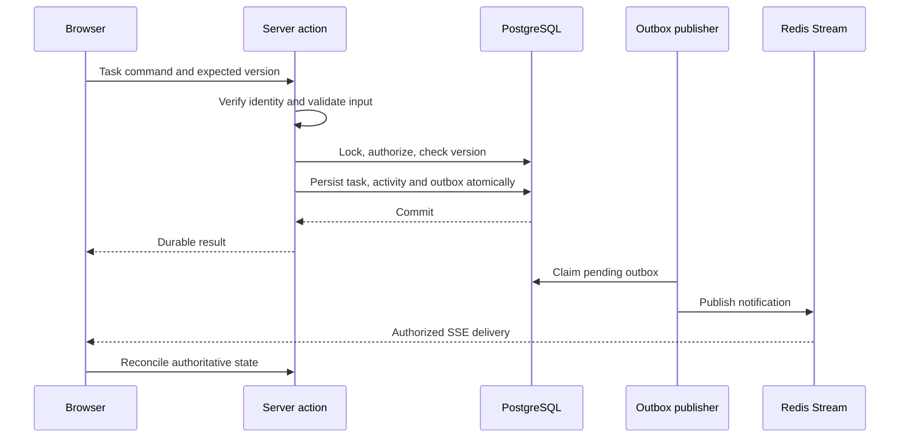

# Saathi QA and system-design study guide

Use this with the [5 November QA review](../release/2026-11-05-persona-qa-review.md), [remediation ledger](../release/2026-11-05-review-remediation.md), and [engineering handbook](../handbook/README.md). Learn the implementation, then explain the failure scenario, the repair, and its verification boundary. The original audit records pre-fix behavior; the ledger distinguishes implemented changes from completed acceptance checks.

## Trace one real request

Start with `app/tasks/actions.ts` → `lib/data/tasks.ts` → `lib/data/events.ts` → `app/api/realtime/route.ts` → `hooks/useRealtime.ts` → `hooks/use-workspaces.ts`.

Explain where each decision occurs. Authentication identifies the caller; membership and task policy authorize the command. Redis delivery is not the task database. Failure after a commit is not proof the mutation rolled back.

## Study sequence

| Session | Read and inspect | Explain without notes | Small exercise |
| --- | --- | --- | --- |
| 1: Ownership and data | Handbook 01; `CONTEXT.md`; migrations; `lib/data/workspaces.ts` | Why owner must be a member; why assignee must belong to the same workspace; why IDs are not permission | Trace owner, member and outsider through the same read and mutation |
| 2: Concurrent edits | Handbook 02; `lib/data/tasks.ts`; QA-02 | Locks serialize transactions; versions reject stale human intent. A correct server check cannot rescue a dishonest client version/field pairing | Two tabs start at v1; one saves v2; identify exactly which version the other must send |
| 3: Retries and unknown outcomes | `lib/data/command-receipts.ts`; create-retry tests | After a timeout, the client may not know whether the command committed or was rejected. Stable command ID and request hash make selected retries safe | Lose the response after commit; retry same ID, then same ID with different input; revoke access before another retry |
| 4: Outbox and SSE | Handbook 03; `lib/data/events.ts`; `lib/realtime-sse.ts`; QA-01 | Why database+Redis dual writes need an outbox; why delivery is at least once; stream cursor vs durable event identity; replay gaps | Crash after publish before mark-published; then explain idless SSE control messages after an event with an ID |
| 5: Quotas and authorization | `lib/rate-limit.ts`; `lib/sse-connection.ts`; QA-03/04 | Separate atomic state updates from correct quota ownership. Actor admission and recipient delivery quota protect different resources | Draw INCR/SET interleaving for three requests; show why denied outsider attempts must not drain a victim quota |
| 6: Graphs and consistent reads | `lib/next-work.ts`; `lib/data/task-dependencies.ts`; graph tests | Ready depends on all recorded prerequisites, not the current visible page. Explain cycle detection and serialized competing edge writes | A→B and B→A submitted concurrently; show why checking cycles outside the transaction fails |
| 7: Operations and honest evidence | Handbook 05; dated release/performance records | Readiness is not capacity; local diagnostics are not hosted SLOs; backup existence is not restore proof | Design one measured workload and one restore rehearsal with explicit success criteria |

## Five questions an interviewer could ask

**Why not publish straight to Redis after saving?** A crash between the database commit and publish loses the notification obligation. The outbox persists the obligation with the domain write. A crash after publish but before marking delivery can duplicate publication, so consumers must tolerate it.

**Why use both a lock and a version?** The lock handles simultaneous transactions. The version rejects a later request based on an earlier view. QA-02 shows the client must retain the version that belongs to its draft, not simply attach the newest prop version.

**What does reconnect recovery guarantee?** Retained stream history can be replayed from a cursor; when unavailable, the client must reload authoritative state. It does not guarantee infinite history or exactly-once delivery. QA-01 shows protocol-level control messages need their own handling even when domain events are deduplicated.

**What would break first at larger scale?** Treat this as a hypothesis: complete Overview/graph reads, per-connection polling, live identity/database work, workspace-wide write serialization and provider quotas deserve measurement. Cite the recorded failed latency targets rather than claiming an unmeasured bottleneck.

**How do you know tests cover the system?** Describe their boundaries. Pure helpers, source-transpiled component harnesses, real SQL integration, native EventSource, authenticated browser journeys and provider acceptance answer different questions. A stub that always allows event processing can conceal a real deduplication bug.

## Practical demo to rehearse

Failures found during production-mode verification are useful interview examples:

- A local Auth timeout returned HTTP 504, but the login action described it as invalid credentials. Authentication rejection and provider unavailability require different recovery guidance. The fix preserves credential rejection while returning a retryable service message for transient and rate-limit failures.
- A stale settings save was correctly rejected and the database stayed at version 2, but the browser showed a minified framework error. Throwing an expected business error across a production Server Action boundary did not preserve its message. The settings action now returns an explicit, safe result; unexpected errors remain generic, and the original action contract is preserved for other callers.
- The document had no horizontal overflow, yet a long title expanded an inner mobile Board column and was clipped. Page-width and automated accessibility checks did not establish component layout correctness. Screenshot inspection exposed the defect; verify the column and title bounds as well as the document width.

Explain why unit tests with a directly thrown JavaScript `Error` missed the second problem. The production browser test checked the serialization boundary as well as database correctness. Use the remediation ledger for the final verification status of both repairs.

1. Use separate owner and member browser contexts and disposable accounts.
2. Create a workspace and a task; reload to establish persistence.
3. Invite the intended account; show that a different account cannot accept its link.
4. Assign and complete a task as member; observe and reload owner state.
5. Open the same task in two sessions and demonstrate an honest stale-edit conflict without losing the draft.
6. Interrupt delivery, change data, reconnect and compare the screen with authoritative state.
7. Remove access and verify subsequent read, write and subscription denial.
8. Show the exact revision, test scope, known limits and cleanup outcome.

Do not present simulated module tests as a live multi-user demo. Do not claim full signup coverage from admin-created confirmed fixtures. Keep synthetic credentials out of reports and screenshots.

## How to discuss the UX review

Distinguish justified system complexity from user-facing complexity. Transactions, permissions and recovery exist to protect users. Repeated task classifications, unstable navigation context and manual draft reconstruction add effort without proving correctness.

A useful simplification proposal has a concrete user outcome: one obvious next action; a stable workspace identity; consistent timezone labels; readable pending/error/stale states; retained drafts. Validate it with owner/member/mobile journeys before changing several screens together.

## Completion standard

For every mechanism, be able to state its invariant, show its implementation, demonstrate a failure case, identify its tests, and name one limitation. For every repaired defect, retain the failing reproduction and passing regression. Portfolio value comes from this understanding and evidence, not from the number of frameworks in the stack.
