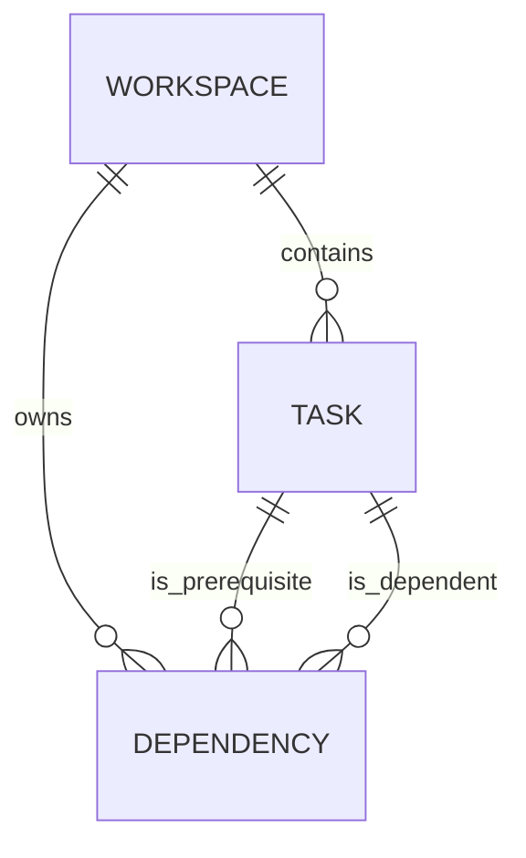

# Saathi Next work — functional requirements

**Status:** draft for review, 27 October 2026. This is a proposed delta to `saathi-v1-product-requirements.md`, not shipped behavior or authorization to deploy/migrate data. Defaults below are recommendations, not decisions attributed to the user.

## 1. Problem and product outcome

A small team needs to see what can move forward, what is waiting and why, without manually maintaining a separate sprint. The testable product hypothesis is that an evidence-backed view of existing tasks and their explicitly recorded prerequisites makes the next action easier to find. Competitors offer overlapping functions; no comparative advantage is established.

**First release:** one workspace-scoped Next work view, explicit prerequisite management, understandable reasons, and an action that opens the authoritative task. Reuse task creation, completion, permissions, activity, realtime and persistence. No infinite canvas is required to establish this feature's value.

**Success:** in the representative five-task flow, a team member identifies the correct ready task and its prerequisites, opens it, and sees the view change after a prerequisite is completed or reopened. Product impact is measured separately through user tests and later real use.

## 2. Actors and boundaries

- **Workspace owner, task creator, assignee and other member:** existing task permissions remain authoritative. Members can read authorized workspace tasks. The owner or creator can edit a task; its assignee may toggle completion under existing rules.
- **Dependency editor:** propose that creating/removing a dependency requires existing edit permission on the *dependent* task, current membership, and a non-archived workspace. Task assignees do not gain edit rights merely from assignment.
- **AI:** optional advisory aid; cannot authorize, create dependencies, complete work or invent facts. AI link proposals and richer explanations are deferred from the initial slice.
- **Outsider, revoked member:** subsequent requests are denied and disclose no task, relationship, title, count or explanation; authorization occurs server-side. A read already authorized in a database snapshot before revocation may still finish; once the client observes revocation or denied access, it clears retained workspace data. Cancellation of every in-flight read is not promised.

## 3. Domain vocabulary and logical model

**Prerequisite:** a task whose completion is recorded as necessary before another task is dependency-ready. **Dependent:** the task that waits for the prerequisite. An edge is `prerequisite → dependent` in diagrams; its logical identity is `(workspace, dependent, prerequisite)`. **Dependency-ready:** an unfinished task whose *recorded* prerequisites are all done. **Waiting:** an unfinished task with at least one recorded prerequisite not done. **Completed:** a persisted `done` task, not a readiness state. **Unknown:** readiness cannot be computed from a complete authorized, consistent graph.



A dependency is a directed relationship between two existing tasks in the same workspace. It is not task status, a sprint, an AI inference, a canvas line with unspecified meaning, a saved view or an authorization grant. Existing task statuses remain `todo`, `in_progress`, `done`; no `blocked` status is added. A task with no recorded prerequisites is ready **based on recorded dependencies**; this does not prove absence of external blockers or make it the most important task.

## 4. Functional requirements and acceptance

| ID | Requirement | Acceptance example |
| --- | --- | --- |
| FR-NW-01 | Members can open Next work for an authorized workspace. Show ready and waiting unfinished tasks, with their explanatory prerequisites, assignee/unassigned and an Open task action. | A done → B open → C open shows B ready and C waiting for B; the user can open B. |
| FR-NW-02 | Explain readiness using current authorized task and dependency facts, not model-generated assertions. A root task with no recorded prerequisites shows “No recorded prerequisites.” | For two prerequisites, both names and completion facts are inspectable; no hidden prerequisite is omitted. |
| FR-NW-03 | A task is dependency-ready iff it is unfinished and every recorded prerequisite is done. Multiple prerequisites use AND semantics. Assignment, due date and priority are separate facts. | A ready but unassigned task remains ready and is visibly unassigned. |
| FR-NW-04 | Complete or reopen a prerequisite; after authoritative refresh, readiness changes. Never silently change a dependent task's persisted status or create/assign work. | Reopen A: B becomes waiting. If B is already done, keep it done and flag the inconsistent recorded dependency without rewriting B. |
| FR-NW-05 | An authorized editor can add or remove a confirmed prerequisite for the dependent task. Prevent duplicates, self-links, cross-workspace edges, cycles and stale writes. | Concurrent A→B and B→A cannot both commit. Duplicate retries must not create a second edge or duplicate event. |
| FR-NW-06 | Explain the direction before save: “Task B depends on task A”; a generic related link or AI suggestion is not a prerequisite. The user can inspect and remove a link. | The editor selects B as dependent and A as prerequisite and confirms the exact relationship. |
| FR-NW-07 | Recommend rejecting deletion of a prerequisite while any dependent links exist, with a recovery path to review/remove links first. A normal whole-workspace deletion must still complete under existing owner confirmation. | Deleting A with B depending on it does not silently make B ready. Removing the link explicitly then permits deletion. |
| FR-NW-08 | Retrieve a complete task-and-edge snapshot for the relevant workspace, including prerequisites outside the visible task page; filtered/paginated UI data must not decide truth. | A prerequisite outside the first visible page still causes waiting. An incomplete or failed read is unavailable, never an empty graph. |
| FR-NW-09 | Show loading, empty, unauthorized, read-failure/retry, stale/reconnecting and graph-incomplete states distinctly. Preserve last known display only if clearly labelled stale; remove it on access loss. | A failed edge read never says “No recorded prerequisites” or “All clear.” |
| FR-NW-10 | Preserve expected-version conflict handling; show the current task and retain unsaved dependency edits on conflict. Preserve existing unknown-outcome and duplicate protections. | Two editors change B's dependencies from the same version: the second is told it is stale and can recover. |
| FR-NW-11 | Search/filter may narrow visible rows but never delete hidden selections or alter prerequisite evaluation. Display remaining results and show why a task matches. | Search C while B is hidden: C still shows B as its prerequisite. |
| FR-NW-12 | Provide accessible names, keyboard access, focus restoration, status announcements and responsive reflow at 360 px. Screen-reader users receive the relationship and reason in text. | A keyboard user can inspect an item, edit permitted dependencies, cancel and return focus without losing input. |
| FR-NW-13 | Generate activity and durable outbox events atomically with dependency edits. Reuse existing task-version and reconciliation patterns; ensure active views re-read on task, dependency and membership changes. | After a committed edge edit, another authorized session refreshes; reconnect re-reads canonical data. No realtime delivery failure changes the committed outcome. |
| FR-NW-14 | The deterministic view works when AI is disabled or unavailable. No new provider call is required for readiness. | Groq unavailable: the same fact-based readiness and task actions remain usable. |

**Example fixture:** A Define login → B Build API → C Connect frontend → D Test mobile → E Release. With A/B done and C/D/E open: C is ready; D waits for C; E waits for D. With B reopened, C waits for B. A done task with an unmet prerequisite remains completed, with an inconsistency indicated.

## 5. Presentation and ordering

Use the existing workspace Overview as the first surface, with ready and waiting sections and direct access to all matching work. **Proposed default:** within a section, order by due calendar date in workspace timezone, ascending. A precise instant is converted to that local date; on the same local date, precise instants sort chronologically before date-only commitments, then by stable task ID. Undated tasks sort last by task ID. This ordering convention does not convert a date-only commitment into an instant or change overdue semantics; test DST boundaries and equal instants. A due date is a commitment, not a proven priority; never manufacture dates. Completed inconsistencies are distinct from current ready/waiting items. Do not force actions in dependency order or block existing authorized completion in v1; surface inconsistent completion instead. Preserve selection and input across filters, errors and refresh.

## 6. Logical commands and read contract

These are proposed application contracts, not existing public APIs:

```
readNextWork(workspaceId) -> { asOf, ready[], waiting[], completedInconsistencies[] }
item -> { task, readiness, prerequisites: [{ taskId, title, status }], unassigned }
addPrerequisite(workspaceId, dependentId, prerequisiteId, expectedDependentVersion, commandId)
removePrerequisite(workspaceId, dependentId, prerequisiteId, expectedDependentVersion, commandId)
```

Commands re-check current user, membership, workspace status and dependent task edit rights; identity is never supplied by the browser as authority. Responses distinguish validation/cycle, conflict, permission/unavailable and unknown outcome without exposing inaccessible task details. A successful dependency change increments the dependent task version. A command ID and request fingerprint support an authorized same-result retry and prevent duplicate activity; extending existing receipts is a design proposal and requires a reviewed migration. If a command result is unknown, retry uses the same ID. A replayed receipt can represent an older task version after later edits; refresh authoritative data and never overwrite newer client state with a historical receipt.

## 7. Concurrency, data lifecycle and safety requirements

- Same-workspace endpoints, self-edge and duplicate constraints must be enforced at the durable boundary; graph-cycle prevention must also be atomic under competing writes. The existing workspace row lock is a candidate; all dependency writes and task deletions must use the same ordering/lock discipline, and real concurrent transactions must prove it.
- A graph read uses one consistent snapshot, an established pattern in `lib/data/tasks.ts`. The system must not infer ready from a partial dataset or missing endpoint.
- A result is current as of its read, not a reservation: subsequent writes require fresh authorization and version checks.
- Proposed conservative task deletion rule in FR-NW-07 is a user-visible contract change. Whole-workspace cascade, dangling links, legacy tasks with no links, rollback and data retention must be explicitly tested. No migration touches hosted data without separate authorization.
- Archived workspaces remain read-only. Member removal must invalidate live views and deny subsequent access. Never leak titles through errors, logs, event payloads, AI or future MCP.

## 8. Scope, dependencies and release gates

Out of scope for this slice: full product rewrite, free-form canvas, visual graph layout, live section/snapshot sharing, notes, cross-workspace dependencies, arbitrary workflow builder, sprint engine, integrations/MCP, automatic task mutations, AI-generated dependencies, bulk scheduling and new AI provider.

Existing evidence: local task, permissions, advisor and reliability code/tests exist. The hosted AI failure remains unresolved. Historical sustained performance acceptance failed; do not equate local correctness or the new feature with production readiness. Existing deployment, migration-history reconciliation, auth, realtime, operational and load-test gates remain separate.

## 9. Validation and product evidence

Automated: pure graph cases (roots, chain, diamond, multiple prerequisites, self/duplicate/cycle, done/reopen, stable dates), authorized database transactions (including two independent connections attempting opposite edges), same-workspace FK and deletion behavior, stale versions, receipt retries, transactional events, consistent full-graph reads, partial reads and paging, archived/revoked users, two-session reconciliation. UI: owner/creator/assignee/other member, keyboard, 360 px, task navigation and all error/recovery states. Prove AI-off behavior.

Compare the same scenario with Miro/Jira and ClickUp using authorized disposable accounts: record plan/configuration, user familiarity, successful steps, time, false-ready/false-waiting, evidence comprehension and recovery. Small exploratory studies are directional and do not prove market superiority. See `docs/product/2026-10-27-next-work-comparison.md`.

## 10. Decisions for review

1. **Deletion:** endorse FR-NW-07's reject-until-links-removed behavior? It avoids silently unblocking downstream work but changes existing delete behavior.
2. **Edit permissions:** endorse dependent task owner/creator editing dependencies, matching current task edit rules? Other members/assignees retain existing permissions.
3. **Completion with unfinished prerequisites:** endorse allowing the existing authorized completion action while visibly marking the inconsistency, rather than blocking it?
4. Due-date ordering, showing all no-prerequisite tasks, and one-workspace-only scope are proposed defaults for the initial experiment; change if the product test suggests otherwise.
