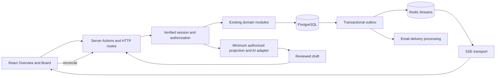

# Saathi v1 engineering baseline

Date: 2026-10-04
Status: Draft for user review. Scope A approved; detailed requirements and targets await review.
Source inspected: implementation checkout at 4dcd78d. No product code changed or runtime checks executed for this design.

## 1. Objective and scope

Make existing Saathi v1 correct, efficient, understandable, and testable. Preserve the small-team outcome model: workspace -> task. Correct defects and simplify measured bottlenecks without expanding the product.

Users: authenticated workspace owners and members; prospective members receiving invitations. Supabase identity is the actor authority. Workspace membership is the access boundary.

Success: critical journeys pass locally and on an isolated hosted environment; no unauthorized access, silent lost updates, or misleading mutation success; measured performance meets the agreed envelope; restore and dependency failure exercises have evidence.

Retain authentication, workspace lifecycle, invitations, tasks, Overview and Board, filters, comments, activity, CSV import, usage signals, optional reviewed AI workspace planning and task advice, and realtime reconciliation.

Excluded: organizations, billing, native apps, attachments, subtasks, dependencies, arbitrary workflows, autonomous AI writes, microservices, and a stack migration without evidence.

## 2. Design options and decision

1. Recommended: retain the modular Next.js monolith, PostgreSQL, Supabase Auth, Drizzle, Redis Streams and SSE; close verified correctness and efficiency gaps.
2. Managed realtime replacement: evaluate private Supabase Broadcast only after the current transport is measured. Requires equivalent isolation, reconnect recovery, and failure behavior; it is a separate decision.
3. Separate backend and realtime service: defer until measured connection load, execution time, or deployment economics require independent scaling.

Option 1 minimizes migration risk and preserves established contracts. Optimize queries and correctness before adding infrastructure.

## 3. Functional requirements (FRS)

| ID | Requirement | Acceptance |
| --- | --- | --- |
| FR01 | Register, confirm email, password login/recovery, Google OAuth, logout, refresh sessions, and preserve intended navigation | Confirmed account reaches its intended authorized route; expired sessions expose recovery; logout removes access |
| FR02 | Create/select/edit/archive/delete workspaces and transfer ownership | Owner is a member; creation and ownership transfer are atomic; archive blocks writes; permanent delete requires explicit confirmation |
| FR03 | Owner invites, resends, revokes, and removes members; intended verified recipient accepts/declines | Seven-day expiry; one pending invitation per normalized workspace/email; acceptance retries produce one membership and acceptance fact |
| FR04 | Members create tasks; creator/owner edit/delete; assignee/creator/owner complete/reopen | Enforce permissions on server; assignee is a current member; stale edits return conflict without overwriting |
| FR05 | Retain current task planning fields and filters | Title 1-200; description <=1000; low/medium/high priority; estimate integer 1-1440 minutes; one assignee; valid date-only or instant deadline, never both |
| FR06 | Overview supports Today/Next/Completed focus; Board supports detailed task management | Both views use the same authoritative task records; lane changes never silently change status or deadlines |
| FR07 | Members add plain-text immutable comments and inspect activity | Comment 1-2000 trimmed characters; activity is not permission authority; deletion follows workspace lifecycle |
| FR08 | CSV import uses the existing task command and reports per-row outcomes | <=512 KiB and <=100 rows; title header required; partial success explicitly reports imported/failed counts and row errors |
| FR09 | Realtime informs clients of committed changes and restores authoritative state | Duplicate events are harmless; gaps, reconnects, and stale events trigger reconciliation; no exactly-once claim |
| FR10 | AI offers authorized summaries/advice and reviewed workspace/task drafts | No mutation before confirmation; confirmation rechecks permissions and input; provider failure leaves manual work available |
| FR11 | Usage signals derive from durable activity | Member-only access; counters survive instance changes; no inference of authoritative usage from process-local counters |
| FR12 | Loading, empty, offline, conflict, unavailable, archived, and denied states are explicit | No optimistic success retained after definitive failure; unknown commit outcome is reconciled before retry |

CSV retry is not automatically safe: an entire re-upload may create duplicates. Retain the current partial-import contract and disclose this; durable import deduplication is not implied.

## 4. Domain, data, and permission design

Retain the logical ERD and entity ownership in ../../architecture/saathi-v1-technical-architecture.md. Profiles mirror auth identity; workspaces contain memberships, tasks, invitations, activity, and delivery obligations; tasks contain comments.

Invariants:

1. Exactly one workspace owner, always a current member. Membership uniqueness and same-workspace assignee validity are database constraints.
2. Identity never comes from caller-supplied email, user ID, role, or AI output.
3. Sensitive authorization and mutation execute within a transaction with a consistent lock order.
4. Domain mutation, activity fact, and outbox obligation commit together. Delivery failure does not undo a successful domain commit.
5. Updates and deletes require an expected version in the target contract. Compatibility timestamps remain only during an explicit caller migration.
6. Archived workspaces remain readable to current members and reject domain writes. Task records do not move between workspaces.
7. Removing members clears assignments before membership deletion. Ownership transfer verifies the new owner is a member.
8. Deadlines retain date-only versus instant semantics; workspace IANA timezone controls presentation.
9. AI output and events are untrusted data. Validate them independently of static TypeScript types.

Permission matrix:

| Command | Owner | Member |
| --- | --- | --- |
| Read workspace/tasks/comments/activity/usage; subscribe | Yes | Yes |
| Create task/comment; ask AI | Yes | Yes |
| Edit/delete task | Yes | Task creator only |
| Complete/reopen task | Yes | Task creator or assignee |
| Workspace administration, invitations, member removal | Yes | No |
| Accept invitation | Intended authenticated recipient | Intended authenticated recipient |
| Confirm AI change | Underlying command permission | Underlying command permission |

## 5. System design and failure behavior



Keep one deployment and existing module boundaries. Route/action modules translate input and public errors; domain/data modules own permissions, transactions, and persisted invariants. Reuse existing helpers instead of adding a generic service framework.

Mutation flow: authenticate -> validate -> consume applicable limit -> transaction -> permission/version check -> mutation/activity/outbox -> commit -> best-effort delivery -> return authoritative result. If delivery fails after commit, report committed success and monitor pending delivery. If commit outcome is unknown, reconcile before replaying a non-idempotent command.

Read flow: authenticate -> membership-scoped query -> bounded projection -> response. Replace task-list per-record projection queries with a set-based query if equivalence checks pass. Preserve isolation and deterministic ordering.

Failure rules: database unavailable fails durable commands safely; Redis unavailable exposes realtime degradation and follows an explicit rate-limit policy; email failures retain retry obligations; AI failures preserve manual work. Never silently fail open a security-sensitive limiter. Document which commands remain available during Redis failure before changing current policy.

Realtime: retain bounded workspace streams, cursor validation, duplicate suppression, resync, abort cleanup, and connection limits. Active subscriptions must stop exposing workspace updates after membership revocation within the agreed revocation window. Initial authorization alone is insufficient for long-lived access.

## 6. API design

No new public REST API is required. Existing Server Actions remain application interfaces; HTTP handlers cover transport, usage, profile, health, internal delivery, and provider webhooks.

### Existing interface inventory

| Surface | Existing operations | Target contract |
| --- | --- | --- |
| app/actions/workspaces.ts | list/read/create/update/archive/transfer/remove/delete | Session actor; owner checks where required; expectedVersion on versioned writes |
| app/tasks/actions.ts | getTasks/addTask/updateTask/toggleTask/deleteTask/assignTask | Validated task input; server actor; explicit conflict and permission results |
| app/actions/invitations.ts | send/list/read/preview/accept/decline/revoke/resend | Recipient/owner checks; minimal public preview; safe repeated acceptance |
| app/actions/comments.ts | getTaskComments/addTaskComment | Membership and task/workspace relationship checks |
| app/actions/migration.ts | importTasksFromCsv | Existing bounded partial-import result |
| app/actions/workspace-intent.ts | generateWorkspaceDraft/createWorkspaceFromPlan | Reviewed structured plan; authorized transactional creation |
| app/actions/workspace-advisor.ts | askWorkspaceAdvisor/confirmWorkspaceAdvisorDraft | Authorized projection; validated draft; confirmation key |
| GET /api/realtime | workspaceId and reconnect cursor | Authenticated SSE; workspace isolation; bounded replay/resync |
| GET /api/usage | workspaceId | Member-scoped durable usage |
| GET/PUT /api/users | Current profile | Session-owned fields only; no caller privilege escalation |
| GET /api/health/live, /ready | Process and dependencies | 200 live/ready; 503 not ready; no secret-bearing diagnostics |
| POST /api/internal/outbox | Authorized scheduler request | Verify internal authorization before processing; bounded batch/retries |
| POST /api/webhooks/email | Signed provider payload | Verify signature before handling; duplicate-safe state transitions |
| POST /api/realtime/load-test | Isolated benchmark publisher | Disabled in production; explicit test authorization |

### Proposed command result standard

Incrementally adapt existing callers; do not globally change return shapes in one pass.

```ts
type CommandResult<T> =
  | { success: true; data: T }
  | { success: false; error: {
      code: "unauthenticated" | "forbidden" | "validation" | "not_found"
        | "conflict" | "rate_limited" | "unavailable";
      message: string;
      retryAfterSeconds?: number;
    }; currentVersion?: number };
```

This is a proposed contract, not an implemented type. Use one existing shared result module if consolidation is justified. Keep current public adapters until migrated callers are verified.

For task edit, the target input is taskId, updates, and expectedVersion. Success returns the authoritative task and new version. Conflict returns a stable code and currentVersion; authorized reload supplies current data. Missing properties leave values unchanged; explicit clearing must have a documented representation distinct from omission. Retain current assignee-email adapter while durable identity remains user ID.

HTTP semantics: 400 invalid input, 401 unauthenticated, 403 forbidden where safe, 404 missing or deliberately concealed resource, 409 version conflict, 429 limited with retry hint, and 503 unavailable. Server Action failures use structured results rather than pretending to be HTTP responses. Avoid resource existence leaks.

No blind retries for create, toggle, CSV import, or permanent deletion. Prefer explicit target status for retriable status changes; audit all toggle callers before migrating. Invitation acceptance and outbox retries have durable deduplication requirements. AI confirmation currently uses temporary Redis claims; stronger durable retry safety must be designed if retry beyond the claim lifetime is promised.

Collections need deterministic ordering and a bounded workload. Retain current callers initially; add pagination only when the accepted envelope cannot be met. Event schemas remain documented in ../../realtime.md; distinguish outbox event identity from Redis/SSE delivery identity.

## 7. Nonfunctional requirements (NFRS)

All numeric values below are proposed beta acceptance targets, not measured results or contractual SLAs. Review before implementation and benchmark using representative seeded data, isolated provider resources, and documented region/network conditions.

| ID | Requirement and proposed target | Evidence |
| --- | --- | --- |
| NF01 | Zero unauthorized reads/writes/subscriptions across workspace boundaries | Negative tests plus hosted two-user checks |
| NF02 | Zero silent lost updates; domain/activity/outbox atomicity | Concurrent database tests and forced failure exercise |
| NF03 | Beta envelope: 100 concurrent authenticated users, <=25 members and <=1000 tasks per tested workspace | Repeatable workload; report request rate, connection count, dataset, duration, errors |
| NF04 | Warm API task reads/mutations p95 <=750 ms excluding AI/email; realtime commit-to-observer p95 <=2 s under NF03 | >=15-minute authenticated run; p50/p95/p99 and >=1000 measured operations/events |
| NF05 | Core request failure rate <1% under NF03, excluding intentionally invalid/denied/limited requests | Separate unexpected failure counts from expected responses |
| NF06 | Membership revocation prevents further protected commands immediately; active realtime access revoked within <=30 s | Remove-member exercise on an already-open subscription |
| NF07 | Reconnection reconciles visible state within <=5 s after a healthy connection is restored | Disconnect, replay gap, duplicate, stale-event exercises |
| NF08 | Keyboard-complete core journeys, visible focus, labels, and no known critical accessibility failures; usable at 360 px viewport | Automated checks plus manual keyboard/mobile review |
| NF09 | Proposed recovery objectives: RPO <=24 h, RTO <=4 h | Backup policy and timed restore into disposable database |
| NF10 | Sanitized central logs correlate request/domain/delivery failures; dependency and outbox backlog alerts are exercised | Observed alert and incident record; process-local counters are insufficient |
| NF11 | AI raw prompts/context/responses not persisted by default; AI operational metadata retained <=30 days | Data inspection and retention processing check |
| NF12 | Report infrastructure and AI costs for NF03 before setting a budget cap | Measured provider usage and owner-approved monthly budget |

Availability percentage, monthly budget, operational owner, and invitation/activity retention durations require explicit owner decisions. Their absence blocks a production readiness claim, not drafting or local correctness work. Do not invent those decisions.

## 8. Evidence-backed gaps and unresolved checks

| Finding | Evidence | Classification and next check |
| --- | --- | --- |
| Task list performs one projection query per task after fetching IDs | lib/data/tasks.ts listTaskRecords/projectTask | Confirmed query pattern; benchmark and replace with equivalent joined query |
| Task concurrency input remains optional and accepts timestamp or version | app/tasks/actions.ts; lib/data/tasks.ts | Confirmed interface mismatch with strict target; inspect matchesTaskVersion and all callers before calling it a lost-update defect |
| Task errors mostly expose strings; machine code currently only rate_limited | app/tasks/actions.ts publicError | Confirmed contract limitation; migration must cover UI consumers |
| Overview focus and CSV/AI capabilities are incompletely represented in older FRS | product requirements compared with migration and advisor/intent actions | Documentation gap; this baseline retains actual capabilities |
| Workspace locking serializes task mutations within a workspace | lib/data/tasks.ts lockWorkspace | Confirmed design; keep unless contention measurements justify narrower locking |
| AI confirmation deduplication uses ten-minute Redis claims | app/actions/workspace-advisor.ts | Bounded mechanism; do not claim durable indefinite idempotency |
| Hosted restore, alerts, email delivery and two-user checks were pending in dated evidence | release/2026-09-22-operational-readiness.md | Historical record only; refresh before reporting current status |
| Active subscription revocation, Redis failure policy, clear-vs-omit fields and commit/delivery error handling | Full caller and implementation review needed | Unverified; explicit acceptance checks, not asserted defects |

## 9. Verification and traceability

| Requirements | Verification |
| --- | --- |
| FR01 | Auth boundary tests and hosted callback/session/refresh/password recovery |
| FR02-04; NF01-02 | Database collaboration tests, stale writes, ownership transfer/removal races, negative authorization |
| FR05-06 | Task contract/deadline tests; Overview/Board consistency and conflict recovery |
| FR07 | Comments integration tests; activity transaction and deletion checks |
| FR08 | CSV parser plus action integration: invalid rows, partial success, limits, permissions |
| FR09; NF06-07 | Realtime tests plus connected revocation, retry, duplicate/gap/failure exercises |
| FR10; NF11 | AI validation/permission/confirmation tests; provider failure and retention checks |
| FR11 | Durable usage query correctness across reconnect and instance changes |
| FR12; NF08 | Browser core journeys, keyboard/mobile and optimistic rollback checks |
| NF03-05, NF09-10, NF12 | Authenticated benchmark, disposable restore, observed alerts and cost record |

Existing npm scripts: type-check, lint, test, build, test:database. Database checks require a disposable database. Runtime verification must record commit, environment, commands, results, and limitations. No test passage or production readiness is claimed by this document.

## 10. Functional completeness and feature flags

Added for user review after initial specification approval. Completeness means every retained v1 capability is usable through its full lifecycle, with permissions, errors, persistence and recovery verified. A source file or visible button alone is not completion. Disabled optional functionality must not be counted as delivered user functionality.

Create one capability matrix in the execution evidence document: capability, entry UI, action/route, authoritative module, permission, happy path, negative path, refresh/reconnect behavior, flag state, local evidence, hosted evidence, and remaining blocker. Populate it for FR01-FR12, including both Overview and Board, task field clearing, search/filtering, invitations and all lifecycle transitions, ownership transfer, archive/delete, comments/activity, CSV, usage, AI planning/advice/confirmation, and session recovery. Classify each as verified, implemented but unverified, missing/broken, or intentionally optional/disabled. Every missing/broken in-scope capability needs a minimal correction or an explicit reviewed scope decision; do not mark the whole product complete with hidden gaps.

### Flag design

Reuse lib/feature-flags.ts and its tests. The existing NEXT_PUBLIC_ENABLE_AI_WORKSPACE flag is enabled only by the exact string true. It currently supplies client and server gates. Public Next.js environment values are build-time configuration: they are not a runtime emergency switch.

Start with environment-level flags, without a vendor SDK, admin UI, database flag table, percentage rollout, or per-user targeting. Only optional/provider-dependent capabilities need flags initially:

| Capability | Proposed server flag | Default when absent | Disabled behavior |
| --- | --- | --- | --- |
| AI workspace planning and advisor/confirmation | ENABLE_AI_WORKSPACE | false | Hide AI entry points; reject direct generation/confirmation calls; manual work remains usable |
| CSV import | ENABLE_CSV_IMPORT | true | Hide import controls; reject direct import action; existing imported tasks remain ordinary tasks |

CSV is enabled by default to preserve existing functionality. Missing/invalid AI values disable AI; absent CSV enables it but invalid explicit CSV values disable import and produce configuration diagnostics. Enforce configured flags at each protected server action invocation, before provider calls or writes. Never gate authentication, authorization, membership checks, validation, transactions, audit/outbox integrity, or version checks.

The server resolves a serializable capability projection for the dashboard; the browser uses that projection for visibility. Capability flags are not permissions or secrets. Existing NEXT_PUBLIC_ENABLE_AI_WORKSPACE is a temporary legacy fallback only when ENABLE_AI_WORKSPACE is absent; explicit server false overrides legacy true. Migrate all current callers, including guide content and workspace intent, before removing the public flag. Verify explicit false remains effective even with a stale browser showing AI controls.

Deployment environment flags are operational controls applied through the hosting platform's supported update/redeploy lifecycle. Document the effective configuration and commit per environment. Do not promise instant disable without redeployment. If immediate incident switches or cohort targeting become necessary, evaluate a runtime configuration store separately with a bounded cache lifetime and defined outage policy.

Disabling flags never deletes persisted data. A flag check before dispatch does not cancel an already-running provider request or transaction; document that boundary. Recheck at command entry for AI confirmation. Continue queue processing for already-committed obligations. Realtime and email retain explicit degraded-mode handling; do not add transport-disable flags until reliable refresh/polling or invitation-link fallbacks have been verified.

FR13: optional capability flags must agree between UI and server, preserve permission enforcement, have documented defaults, and work through direct calls as well as the UI. Verification: default/true/false/invalid parsing, server-over-legacy precedence, stale-client rejection, disabled AI provider call count zero, disabled CSV mutation count zero, and on/off core journey checks. Each flag records purpose, owner, environments, default, operational procedure, and removal/review condition.

## 11. Delivery and review gates

Proposed order: reconcile contracts/callers -> close authorization and consistency defects -> optimize task reads -> verify recovery and dependency behavior -> hosted journeys/accessibility -> benchmark and operations evidence. Each slice needs a minimal focused check and preserved unrelated behavior.

Use additive migrations first, inspect compatibility, and separate application rollback from data recovery. Test migrations on a fresh and representative existing disposable database. Never use production reset as a restore exercise.

Existing README modifications and untracked interview/closeout documents are unrelated work and must remain untouched.

Design exit criteria: user approves this scope, behavior, target envelope, and explicitly pending owner decisions; contradictions are resolved; every retained capability has a contract and acceptance path. Then write a focused implementation plan using Superpowers writing-plans and obtain execution-method approval. No commit, push, deployment, production mutation, or external issue publication is authorized by scope approval.

This baseline consolidates the engineering target for review. Existing architecture and product documents remain historical/current references until approved reconciliation; this draft does not silently supersede them.

## 12. Core journey completion and simple UX follow-up

Status: Proposed follow-up design for user review, 2026-10-04. This section does not declare onboarding or AI help implemented.

### Confirmed gap and smallest correction

Two independent browser sessions verified create/join/assign/complete/refresh. The member Board task title was disabled even after assignment: viewing details is currently coupled to edit permission. Current members must be able to read task details and add comments regardless of creator/assignee status. Owner/creator editing and assignee completion rules remain unchanged. Reuse the existing task detail surface with read-only fields for members without edit permission; keep comments usable. Check Overview deep links as well as Board titles. Server reads/comments continue to verify membership.

### Functional acceptance ledger

FRS completion is assessed per journey, not per file or test count. Maintain FR01-FR13 rows with exact input, role/preconditions, expected visible result, database effect, denied/failure result, refresh/reconnect behavior and evidence location. Add a separate negative/edge check for every administrative or persisted command. Run these stages in order:

1. Owner creates workspace; teammate joins; task is created, assigned, opened, discussed, completed and reopened; both sessions remain consistent after refresh.
2. Owner edits/transfers/archive/deletes and removes members; member and outsider restrictions hold. Use only named disposable fixtures for destructive lifecycle checks.
3. Search/filters, date-only and instant deadlines, field clearing, CSV partial outcomes and usage signals agree with durable state.
4. Session expiry, conflicts, denied access, interrupted responses, duplicate delivery and reconnect recover without misleading success or duplicate writes.
5. AI on/off, reviewed workspace/task drafts and provider failures preserve the manual journey.

Do not mark FR07 complete until members can reach comments through the UI. Signup confirmation, OAuth, email delivery and real Redis remain separate provider checks; seeded password login and mock transport are narrower evidence.

### Simple experience proposal

Use one main workspace entry, with Overview for daily focus, Board for detailed management, Team for membership and Activity for history. Settings remain owner-only. Propose Overview as the default workspace landing view; confirm this explicit change before implementing it. The assistant is an optional contextual action, rather than a competing primary workspace mode. Retain existing AI capabilities through that action, without duplicating task/workspace commands.

Task creation asks for title first; description, assignment, priority, deadline and estimate remain available through progressive disclosure in the existing detail form. Task titles always open details for authorized members. Keep one clear next action in an empty state: create workspace, add first task, or invite a teammate as appropriate. Use identical terms across UI, errors and documentation. Disabled optional AI should not advertise actionable planning controls or imply provider availability.

Acceptance: owner and member can complete the basic journey using labels alone; no unexplained disabled read controls; keyboard access and visible focus; usable at 360 px; navigation survives refresh/deep links; loading/error/conflict feedback offers a specific recovery action. Evaluate with a scripted walkthrough and, separately, actual new-user feedback; an agent walkthrough is not a usability study. No custom tour dependency or dashboard redesign is required to fix the confirmed gap.

### NFR work stays explicit

Security/consistency and accessibility accompany each code slice. Realtime revocation/reconnect/failure checks follow the complete collaboration journey. Performance targets require representative 10/100/1000-task timings and the approved concurrent-user workload; query-count reduction alone does not satisfy them. Alerts, backup restore, retention and cost evidence remain scheduled operational gates. Current test resources are authorized; fresh deployments are deferred to deployment day. No requirement is silently dropped because it cannot be measured locally.

### Foundation for later onboarding and AI help

First reconcile existing guide/help content, lib/product-guide.ts and lib/overview-capabilities.ts with verified capabilities, flags, terminology and role rules. These remain authoritative product descriptions; do not invent a second metadata framework merely for future AI.

Later onboarding follows user state: no workspace -> create/join; empty workspace -> add first task/invite; established workspace -> assign/execute/review. Support invited-member entry as well as owner creation. Completion is based on committed product state, not inferred chat text. Store dismissal/progress only when onboarding implementation is approved.

Future AI help explains approved workflows and links to real destinations, scoped to current role and feature availability. It must state when a capability is unavailable, avoid sensitive account/workspace context unless necessary and authorized, never invent controls or claim mutations, and offer ordinary guide content when the provider is off. Deterministic routing is sufficient for known help topics; retrieval infrastructure is deferred until guide size or evaluation demonstrates need. Help answers must be checked against a small set of owner/member, AI-off, invitation, conflict and recovery questions before rollout.

Implementation order: member read/comment access -> complete collaboration and negative journeys -> simple navigation/progressive disclosure review -> NFR/provider evidence -> static guide reconciliation -> separately scoped onboarding and AI help. Onboarding cannot compensate for a broken core journey.

## 13. AI capability differentiation and optimization

Status: Proposed design, based on inspected current adapters and actions. No provider performance, cost or quality measurements are claimed.

| Capability | Purpose and input | Computation and boundary | Result and UX |
| --- | --- | --- | --- |
| Product help (future) | How to use Saathi; current role, enabled capabilities and approved guide text | Deterministic topic/link lookup first; optional language explanation. No workspace task contents by default | Explain and link to actual controls; never mutate |
| Onboarding (future) | Next setup step from committed user/workspace state | Deterministic state transition and next action; model unnecessary for progress/completion | Dismissible step guidance; optional explanation |
| Workspace summary | What has happened and current progress | Counts/status/deadline facts computed by code; optional model narrative from authorized facts and bounded task context | Read-only summary; show context coverage/as-of state |
| Attention | Which work needs attention | Code computes overdue, unassigned or high-priority candidates using workspace timezone; model may explain prioritization, not invent blockers | Evidence-linked read-only suggestions; uncertainty explicit |
| Workspace planning | Turn an explicitly supplied goal into an initial reviewed plan | One bounded structured model call, existing plan schema and deterministic validation | Draft workspace/tasks; user reviews then ordinary transactional command saves |
| Task drafting | Turn an explicit request into one proposed task | One bounded structured model call using only relevant authorized context | Draft one task; explicit confirmation reauthorizes and saves |

Help is about product usage; advice is about authorized workspace work; planning/drafting prepares proposed writes. Distinguish these in labels and outputs even if a shared provider adapter is reused. Do not add separate services or an intent-classifier model merely to route explicit capability buttons. Ambiguous free text should ask a short clarification or offer the existing actions, never silently choose a mutation.

### Inspected optimization and correctness opportunities

- buildAdvisorProjection currently includes every task and description for every advisor capability. Use per-capability context; cap tasks and serialized bytes; disclose truncation and keep deterministic totals over the complete authorized dataset. Never call a partial selection a full-workspace analysis.
- askWorkspaceAdvisor currently reads workspace/tasks before checking disabled AI and consuming its quota. Validate the request and flag before expensive reads; authorize membership before applying a workspace-specific request quota; consume quota before task projection/provider work. Missing flag should yield zero provider calls and no task-list work.
- requestWorkspaceAdvisor validates response structure but does not independently require returned capability to equal requested capability or attention IDs to belong to the supplied projection. Add these semantic checks before displaying a response; strict JSON alone does not provide grounding.
- Attention projection lacks a trustworthy current-time/workspace-timezone fact and does not supply dependencies or inactivity evidence. Compute deadline facts in code. Do not infer a persisted blocked status, task dependencies or inactivity from absent data.
- Provider adapter currently uses a shared model and 20-second timeout and does not collect usage from the response. Retain the existing model initially, add bounded per-capability output budgets and sanitized actual usage/latency outcomes before choosing another model. Existing estimatedCostMicros=0 means cost unmeasured; it must not be interpreted as free inference.
- Redis confirmation claims are temporary. Keeping confirmation separate from drafting avoids a second model call and preserves server permissions. Durable retry safety beyond claim lifetime remains a separate correctness decision.

### Smallest implementation order

1. Capability/attention-ID semantic validation, request validation before expensive work, flag/quota ordering and tests for wrong capability, unknown IDs and disabled requests.
2. Deterministic facts for summary/attention, relevant bounded context and honest coverage labels. Define exact bounds in the focused implementation slice and verify edge cases at the limits.
3. Per-capability token/response budgets and actual usage instrumentation; quality evaluation before any provider/model routing change.
4. Only if repeated requests show material cost, consider deduplication/cache keyed by workspace, capability, normalized question and a context revision that includes tasks and workspace facts. Every hit rechecks membership; timezone/date-sensitive advice invalidates at the applicable time boundary. No cross-user content leakage or process-local correctness assumptions.
5. Help/onboarding remain separately scoped, using verified static guidance/state first. No RAG/vector store or autonomous agent framework until evaluation demonstrates need.

### AI verification contract

Use a small representative set per capability: empty workspace, mixed completion, date-only/instant overdue boundaries, large truncated context, wrong capability, unknown task ID, irrelevant question, prompt-like instructions in task text, provider refusal/timeout, disabled feature, removed membership and duplicate confirmation. Require no unauthorized data, no unconfirmed writes, no invented referenced tasks and correct deterministic facts. Evaluate narrative usefulness separately from schema validity. Record call count, input/output tokens when supplied, latency, failure category, context coverage and confirmed-write success. Store no raw task context or conversations by default.

Keep the existing global AI switch as the emergency deployment control. Independent per-capability switches are justified only when a capability is rolled out separately; proposed future names and defaults must be documented at that point. Do not introduce inactive flags for every hypothetical future feature now.
