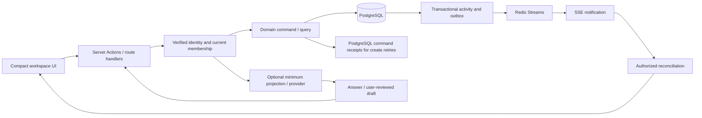

# Compact B UI, UX and architecture mapping

Date: 2026-10-06. Source baseline: `9da6551`, `feature/saathi-interface-refresh`.

Status: Written design for review. Compact B visual direction and preparation of this decision/mapping are authorized. Detailed interaction decisions below are proposed defaults, not shipped behavior or completed acceptance. No application code, database contract, dependency, commit or deployment changes are included.

References: [component inventory](../../architecture/2026-10-06-ui-component-inventory.md), [HLD baseline](../../architecture/saathi-v1-technical-architecture.md), [project map](../../architecture/saathi-v1-project-map.md), [FRS/NFR baseline](../../product/saathi-v1-product-requirements.md), [core roadmap](../plans/2026-10-05-saathi-core-simplification-and-human-ux.md).

## 1. Objective and decision

Help a small team see the next useful action, execute work and recover safely with fewer competing choices. Keep the flat workspace -> task model. Compact means less chrome and stronger hierarchy, not smaller text, hidden navigation or compressed touch targets.

Selected approach: compact the current shell and simplify existing components. Alternatives considered: replace the component library (unnecessary migration with interaction risk); rebuild shell/data ownership together (larger change that mixes UX and reliability). Neither is needed for this direction. Reuse Radix/shadcn, native form controls, current CSS tokens and existing domain commands. Keep AI optional, after the core journey.

Approved inputs: Compact B, Overview -> Board, visible navigation labels, title-first creation, existing functionality and recovery. Proposed defaults: inline filter disclosure, prevent silent draft loss during view/workspace changes through an explicit discard confirmation, one existing Dialog for details, and one consequence-aware confirmation family. These require design review before implementation.

## 2. Keep, simplify, remove

Keep means retain the responsibility and safety behavior; it does not freeze styling. Simplify means a named UX/logic change, not moving code between files. Remove candidate means check all consumers and tests before deleting.

| Scope | Decision | Concrete treatment |
| --- | --- | --- |
| DashboardNavigation, WorkspaceSwitcher | Keep, simplify presentation | Compact labelled rail on desktop; labelled horizontal navigation on small screens; one selected workspace context |
| Dashboard inline header/menus | Simplify | Selector, New task, profile; workspace menu owns New workspace, Activity, owner Settings; profile owns guide, archive, shortcuts and logout |
| WorkspaceOverview | Keep, simplify | One compact progress summary, overdue/today/next groups, shared quick add; completed work collapsed; no large greeting or repeated workspace title |
| WorkspaceBoard, use-task-board | Keep | Bounded server reads, totals, cursor, stale response guards, authorized by-ID detail lookup and versioned writes |
| TaskList, TaskColumn, TaskListItem | Keep, simplify | Compact toolbar and cards; title plus useful due/assignee/priority cues; complete/reopen discoverable; edit/delete/assignment in details or labelled overflow |
| TaskFilter | Keep, simplify | Search always visible; Filter disclosure for existing status/priority/assignee; active selections and Clear filters visible |
| TaskQuickAdd | Keep | One shared title + Add pattern; Add details for current optional fields; draft and unknown-outcome recovery retained |
| TaskEditorDialog | Keep, simplify presentation | Existing accessible modal for deliberate edits and read-only archive inspection; no new details store or parallel editor |
| TaskComments | Keep | Immutable plain-text comments, cursor continuation, pending command identity, draft and read-only mode |
| WorkspaceCreateForm | Keep, simplify | Name is required; goal/date optional; AI suggestion conditional and always reviewed |
| MemberManager | Keep, simplify | Clear owner/member identity, invite action, pending invite/delivery states; advanced access actions secondary |
| InvitationNotifications / InvitationResponse | Keep | Inbox and dedicated-link contexts remain distinct; preserve identity, expiry, retry and workspace refresh behavior |
| ActivityHistory | Keep, simplify | Direct record on Activity view; expandable history only where useful in archive; cursor continuation remains separate unimplemented core work |
| WorkspaceSettings / ArchiveHistory | Keep, simplify | Metadata separated from lifecycle consequences; archive and permanent deletion never conflated; read-only archived task details |
| WorkspaceAdvisor / TaskImport | Keep, conditional | Ask Saathi in workspace context; import in Board overflow; hide entries when capabilities are disabled |
| ConfirmDialog | Keep, reuse | Existing destructive confirmation family; review native settings confirmations for replacement, retaining errors/pending and consequences |
| AuthForm / PasswordRecoveryForm / PageLoader | Keep | Auth journeys and distinct loading, error and zero-workspace states; no redesign scope expansion into provider integration |
| SaathiLogo / SaathiLogoMark / ThemeProvider | Keep | Shared branding and existing root provider; current light-theme setting retained |
| Active UI families | Keep | alert-dialog, avatar, badge, button, card, dialog, dropdown-menu, input, label, progress, spinner, textarea, toast, toaster |
| AssistantWorkspace / TimeSensitiveGreeting | Remove candidates | No current page path; do not restore old Assistant mode or decorative greeting |
| Dashboard handleEditTask / handleDeleteTask | Remove candidates | Definitions have no callers; Board has its own versioned mutation path |
| hooks/useTaskStore | Remove candidate | No current consumer; do not introduce a third owner for task data |
| Unused UI files and duplicate hooks | Remove candidates | Exact source inventory in appendix; whole-repository checks precede deletion |
| lib/saathi-design.ts | Reconcile, then remove candidate | Unimported palette differs from actual CSS tokens; current globals.css is the styling authority for this refresh |
| Packages referenced only by removed source | Review after deletion | Verify production, tooling, scripts and config consumers; uninstall only genuinely unused dependencies and update lockfile |

Do not delete all unreachable files blindly. Transitive primitive dependencies and tests can still need coordinated edits. No claimed JavaScript bundle saving follows from a line count alone.

## 3. Final proposed information architecture

Desktop: narrow labelled navigation, one compact header, task content occupying the remaining space. Mobile: no permanent rail; the same labelled Overview, Board, Team choices and menus. Activity/Settings show their actual view title even though they live in the workspace menu. The selected tab/menu and rendered view must agree.

Primary navigation: Overview, Board, Team. Workspace menu: New workspace, Activity, Settings (owner only). Profile menu: help/guide, archived workspaces, keyboard shortcuts, logout. New task opens/focuses the quick-add area of the active Overview or Board; from Team/Activity/Settings it switches to Board first. Ask Saathi is a secondary contextual action only when enabled.

Existing view compatibility: Overview `#workspace-header` or no recognized hash; Board `#project-board`; Team `#team-panel`; Activity `#activity-history`; Settings `#settings-panel`. Retain these through refresh/back/forward. Arbitrary task URL deep links are not part of this refresh; current in-app by-ID task opening remains supported. Archived work stays at `/archive`; guide/help and invitation/auth routes remain intact.

## 4. UX journeys and acceptance

| Journey | Flow | Acceptance and failure behavior |
| --- | --- | --- |
| Enter | Sign in -> load workspaces -> selected Overview | Loading is not zero; read failure has Retry; zero-success shows create form; no inaccessible data from a prior account |
| First useful action | Create/join workspace -> add a title -> complete task | Manual path works without AI or a tour; one clear primary action; confirmation reflects committed data |
| Create workspace | Name -> optional goal/date -> Create -> Overview | Server creates owner membership atomically; failure retains inputs; cancel returns existing workspace |
| Choose workspace | Selector -> new scope -> current view | Scope change clears stale rows/errors; pending read from old scope cannot update new workspace; dirty local form prompts before destructive navigation |
| Overview | Compact progress -> overdue/today/next -> complete or open | Only actionable facts; missing/loading totals are not zero; completed section collapsed; workspace calendar semantics preserved |
| Add task | Title + Add -> optional Add details -> submit once | Trim/validate title, preserve optional fields; pending guard; success clears confirmed draft; unknown outcome requires reconciliation before retry |
| Board | Search -> filters -> status columns -> Load more | Server searches result set; filters reset cursor; active selections visible; duplicate/stale appends prevented; totals and loaded matches labelled separately |
| Task details | Card title -> authorized detail read -> existing Dialog | Can open outside loaded page; any member can read/comments; editing according to command permission; draft survives realtime/conflict; close with unsaved changes requires explicit discard |
| Execute | Complete/reopen direct action; permitted full edits in details | Assignee completion permission is not permission to edit all planning fields; no inferred new status rights; no drag-and-drop dependency introduced |
| Comment | Details -> plain-text update -> Post -> comments | Blank/oversized input rejected; unknown response preserves draft/command identity; older comments available; archived mode disables writes |
| Invite/join | Team invite -> delivery/link -> invited identity -> accept -> workspace | Email provider status differs from access status; copy link available; wrong account, expired, declined and revoked states explicit; retry cannot duplicate membership |
| Activity | Workspace menu -> record -> older records | Loading/error distinct from empty; direct record avoids a redundant Show click; Load older requires server cursor work before it can ship |
| Settings/lifecycle | Owner Settings -> save/archive/delete/transfer | Versioned metadata/transfer/archive preserved; permanent deletion explicitly names data lost; archive retains read-only inspection; restoration is an unimplemented gap; failures remain actionable |
| Archive | Profile archive -> retained workspace -> task/history | Details read-only; restoration absent from current core; no quick-add/comment writes on archived work |
| Optional assistance/import | Conditional entry -> preview -> confirm | Manual core independent of providers; server capability checks remain; AI cannot authorize, invent persistence success or bypass command validation |
| Recover | Conflict/offline/reconnect/service error -> relevant next action | Offline means updates disconnected, not offline writes supported; reconcile authoritative data; retain drafts; committed write plus failed refresh is not reported as a failed save |

Default Board cards show title, assignee when set, due state when set, and priority where it adds attention. Column supplies status; do not repeat status captions on every card. No fake progress, sample counts or sample activity from the prototype enters production. Whole-workspace totals and loaded filtered results must be distinguishable. Overview currently loads its task projection through useWorkspaces; compact layout does not make that read bounded.

Details organization: title/context, planning/ownership fields, discussion. Keep title, description, status, priority, single assignee, date/instant deadline and estimate discoverable. Existing `bucket` is a planning projection, not a status or custom workflow. Preserve supported fields even when they are secondary.

### Deadline and draft policies

Date-only deadlines remain literal calendar commitments. Precise instants display and group by the workspace IANA timezone in Overview and Board. Native date/time entry uses the browser timezone, explicitly labelled with that timezone; save converts to an instant once, and the UI may explain a differing workspace display zone. Do not silently interpret the same typed value in two zones. Validate browser/workspace differences, DST and local-midnight boundaries before acceptance.

Current gap: groupTasksForOverview uses calendarDateKey for precise instants (UTC date) against workspace-local today; Board due rendering omits the workspace timezone; Quick Add converts browser-local input without identifying that zone. These are correctness fixes, not visual polish. Existing lib/task-time.ts provides the seam; do not add a timezone package before establishing the smallest supported conversion/display change.

Dirty-draft protection applies to managed in-app view/workspace/creation navigation and closing details. Keep editing continues in the same scope; Discard explicitly clears before navigation. No silent reset on realtime. This proposal does not promise draft persistence after logout, reload or browser close and does not add a global task store. Unknown-write recovery must finish before a retry can create a second command.

## 5. HLD: ownership remains unchanged

The refresh changes presentation and interaction hierarchy in the existing modular Next.js monolith. It creates no new service, table, public REST resource, organization hierarchy or domain authority.

| HLD boundary | UI responsibility | Authority / source |
| --- | --- | --- |
| Identity | Login/recovery/session states | Supabase Auth; lib/auth-simple.ts, lib/supabase |
| Workspace containment | Selector, Team, Settings, archive | Current PostgreSQL membership; lib/data/workspaces.ts |
| Task facts | Overview, Board and details render same domain | lib/data/tasks.ts and task-contract.ts; no UI store grants rights |
| Discussion/audit | Comments/Activity display retained facts | lib/data/comments.ts, activity.ts, events.ts |
| Durable change | UI waits for meaningful mutation result | PostgreSQL domain + activity/outbox transaction; command_receipts retain supported create retry identity |
| Coordination | Live/offline state and refetch triggers | Redis/SSE are delivery, not durable task truth |
| AI | Optional answer/proposal review | Server-only minimum read model; deterministic commands persist |
| Feature availability | Conditional entry/discovery | Server capability enforcement; feature-flags.ts |

## 6. LLD: components -> contracts -> data

| UI path | State/component owner | Actual boundary symbol | Data/domain owner |
| --- | --- | --- | --- |
| Workspace entry | Dashboard -> useWorkspaces | getUserWorkspaces(userEmail), createWorkspace(name, details?) | listWorkspaces, createWorkspaceRecord in lib/data/workspaces.ts |
| Overview | WorkspaceOverview / useWorkspaces | getTasks(workspaceId); task-overview grouping | listTaskRecords, workspace timezone |
| Board first/more page | WorkspaceBoard -> useTaskBoard | getTasksPage(workspaceId, input) | listTaskRecordsPage; workspace/filter-scoped cursor |
| Board totals | useTaskBoard | getWorkspaceTaskAggregates(workspaceId) | getTaskAggregates; whole-workspace counts |
| Details outside page | WorkspaceBoard | getTaskById(workspaceId, taskId) | getTaskRecord; authorized containment |
| Create task | TaskQuickAdd -> current mutation callback | addTask(..., commandId?) in app/tasks/actions.ts | createTaskRecord; command receipt |
| Edit/delete/complete | TaskList / WorkspaceBoard; Overview completion | updateTask(taskId, updates, expectedVersion); deleteTask/toggleTask(taskId, expectedVersion) | changeTaskRecord, task-permission, version checks |
| Discussion | TaskComments | getTaskComments(taskId, cursor?); addTaskComment(taskId, body, commandId?) | listTaskCommentsPage/createTaskComment |
| Team | MemberManager / workspace callbacks | sendWorkspaceInvitation, getWorkspaceInvitations, removeMemberFromWorkspace, transferWorkspaceOwnership | invitations.ts/workspaces.ts; current owner/member checks |
| Join | InvitationResponse / InvitationNotifications | acceptInvitation(id), declineInvitation(id) | respondToInvitation with intended verified identity |
| Activity | ActivityHistory | getWorkspaceActivity(workspaceId) | listActivityEvents; currently limit-based, no cursor API |
| Settings | WorkspaceSettings | updateWorkspace(id, input, expectedVersion), archiveWorkspace(id, expectedVersion), deleteWorkspace(id) | update/archive/deleteWorkspaceRecord |
| Archive | ArchiveHistory | getArchivedWorkspaces(), getTasks(workspaceId); no restore action exists | workspace lifecycle plus authorized read-only task projection |
| Flags | Dashboard capability state | getFeatureCapabilities() -> resolveFeatureFlags(process.env) | Server enforcement in optional action boundary |
| Ask/confirm | WorkspaceAdvisor | askWorkspaceAdvisor / confirmWorkspaceAdvisorDraft | lib/ai, task commands and AI-operation metadata |
| Workspace suggestion | WorkspaceCreateForm | generateWorkspaceDraft / createWorkspaceFromPlan | Validated reviewed workspace plan and command |
| Import | TaskImport | importTasksFromCsv(workspaceId, csvText) | CSV validation and existing domain writes |

Function names identify current interfaces; parameter tables in source remain authoritative. Calls shown as `expectedVersion` use the existing number|string task concurrency parameter even where it is named expectedUpdatedAt. Do not silently change action signatures to make naming prettier.

Contract facts to preserve:
- TaskStatus at UI boundary: `todo | in-progress | done`; database: `todo | in_progress | done`. lib/data/tasks.ts maps storage projection. Status copy is To do, In progress, Done.
- TaskPageInput: search, active/completed/all, priority, assigneeEmail, cursor, limit. Default Board fetch 50; schema max 100. Cursor belongs to workspace and filter scope. Search max 200. This refresh adds no numbered-page API or client-only whole-dataset search.
- TaskAggregates describes the workspace; page.tasks describes loaded matches. Column counts from the loaded page must not be presented as authoritative whole-column totals.
- Task title 1–200, description max 1000, estimate integer 1–1440; only one dueDate or dueAt. Single assignee must belong to workspace. Display emails are projections; database identity is UUID.
- TaskMutationResult currently has optional success/error/task/code/retryAfterSeconds/unknownOutcome. Generic getMutationError only reads error text. Preserve conflict current-task data and uncertainty; do not treat every object without error as durable success in a new shared wrapper.
- AI enables only exact `true`; CSV currently defaults enabled when unset and enables on exact `true` otherwise. Capability-load failure currently hides both. UI visibility complements server enforcement; flags do not authorize a user.
- Workspace deletion currently has no expectedVersion parameter, whereas archive/metadata/transfer do. Document this accurately; adding a deletion version guard is separate behavior/contract work.

## 7. Source/document reconciliation

Existing architecture/project-map files are already modified in the working tree. Preserve those edits. This dated design is an additive mapping, not a silent rewrite of historical release evidence.

| Reference | Drift / clarification | Resolution before implementation closes |
| --- | --- | --- |
| Product FRS FR-6 | Says authenticated home is Board | Amend intended home to Overview with Board execution, preserving FR-6 capabilities |
| FRS FR-7 | Locates optional AI on Overview | Describe contextual Ask Saathi entry across workspace views; no Assistant mode |
| FRS canonical fields | Uses DB identity/status names alongside UI language | Add explicit DB-to-UI mapping, retain UUID authority/email projection |
| HLD authorization matrix | Broad edit/archive/delete expected-version wording | Distinguish actual versioned commands from unversioned deletion; no claim of a guard absent from source |
| Dashboard state prose | workspace-ready terminology versus helper/source labels | Semantic zero-workspaces/creating-workspace/workspace-ready map to helper empty/creating/workspace; error/zero distinction remains invariant |
| Archive inventory | Earlier inventory mistakenly described restoration | Corrected inventory: read-only inspection only; no restore command/UI found; design any restoration separately |
| Timezone behavior | UTC grouping and browser-local entry conflict with workspace display | Apply explicit policy above with focused correctness verification |
| Older Board map | app/tasks/page.tsx listed as Board owner | Actual chain: Dashboard -> WorkspaceBoard -> useTaskBoard -> TaskList; tasks route redirects |
| Old Redis claim description | Omits durable create command receipts | Document PostgreSQL command_receipts for task/comment retry identity; Redis claims remain temporary |
| Inventory unused files | Static reachability, not safe-deletion proof | Run whole-repo consumer/test/config checks before removing candidates |
| Prototype | Fictional metrics and memory-only controls | Use visual treatment only; production data/error/permissions define interactions |

## 8. FRS and NFR traceability

| Requirement | UX surfaces | Verification obligation |
| --- | --- | --- |
| FR-1 access | Auth, selector, details, all protected views | Non-member/revoked/account-switch reads and writes denied; no stale records |
| FR-2 lifecycle | Creation, Settings, archive | Owner membership atomic, metadata conflicts, archive/read-only/delete consequences; restoration gap tracked separately |
| FR-3 invitations | Team, inbox, invitation link | Intended identity, expired/revoked/duplicate accept, delivery fallback |
| FR-4 tasks | Quick add, Board, details | All supported fields and roles, assignee containment, status/version/deadline behavior |
| FR-5 discussion/history | Details/comments, Activity/archive | Pagination, immutable comments, authorized history, transaction evidence |
| FR-6 daily work | Overview -> Board | Navigation/content agreement; manual add/complete without tour; honest loading/filter/count/recovery |
| FR-7 AI | Conditional Ask Saathi and suggestion | Disabled core still works; minimum authorized data, no auto-write, explicit confirmation |
| NFR correctness | All mutations and refetch | Drafts/version/receipt behavior unchanged; no blind uncertain retry |
| NFR security/privacy | Every role/feature | Existing server enforcement and no secret/provider context leakage |
| NFR usability | Desktop/mobile/keyboard | 360px journey without horizontal page overflow; visible labels/focus; keyboard-complete controls; readable errors and retained drafts |
| NFR performance/scale | Board/Overview/realtime | Measure same fixture/build requests and bundle; preserve Board bounds; Overview unbounded projection and sustained load remain open gates |
| NFR operations | Offline/recovery/retention | Service feedback does not imply durable failure; hosted scheduling, backup restore, monitoring and auth/provider acceptance remain independent gates |

Existing target gates remain: 100 distinct active users/100 connections, 1000 tasks per tested workspace, warm task API p95 <=750ms, durable commit-to-observer p95 <=2s, unexpected failures <1%, at least 15 minutes/1000 measured operations or events. Stream revocation <=30s, reconciliation <=5s after healthy reconnect. These are requirements from the existing plan, not achieved results. Compact B does not close them.

## 9. Review and implementation order

1. Review this written flow and interaction defaults, especially dirty-draft navigation and card/detail action placement.
2. Confirm keep/simplify/remove manifest against whole-repo consumers. Freeze source/request/bundle baseline; documentation/relocation do not count as code reduction.
3. Implement compact shell/navigation and Overview/Board presentation using existing behavior. No cache-library migration in this slice.
4. Simplify details/filters/Team/Activity containers and confirmation consistently, preserving contracts. Server Activity continuation is a separately testable core slice before exposing Load older. Fix deadline grouping/display correctness under the explicit timezone policy before visual acceptance.
5. Remove confirmed unused source and associated dependencies in a separate reviewable slice; update source-based tests meaningfully rather than deleting behavioral coverage.
6. Reconcile FRS/HLD/LLD wording without modifying unrelated draft content; run rendered journey acceptance plus focused existing tests/type/lint/build. Record results separately from proposed design.

This is the design and architecture decision map, not a code-level implementation plan. The already-existing simplification plan remains the broader core/NFR roadmap. After design review, write the narrow implementation tasks from this map; no new repository, service, UI framework or speculative onboarding/AI help engine is introduced.

## Appendix: exact dormant shared UI candidate manifest

From the source inventory; final deletion still requires whole-repository consumer checks:

- components/ui/accordion.tsx
- components/ui/alert.tsx
- components/ui/aspect-ratio.tsx
- components/ui/breadcrumb.tsx
- components/ui/button-group.tsx
- components/ui/calendar.tsx
- components/ui/carousel.tsx
- components/ui/chart.tsx
- components/ui/checkbox.tsx
- components/ui/collapsible.tsx
- components/ui/command.tsx
- components/ui/context-menu.tsx
- components/ui/drawer.tsx
- components/ui/empty.tsx
- components/ui/field.tsx
- components/ui/form.tsx
- components/ui/hover-card.tsx
- components/ui/input-group.tsx
- components/ui/input-otp.tsx
- components/ui/item.tsx
- components/ui/kbd.tsx
- components/ui/menubar.tsx
- components/ui/navigation-menu.tsx
- components/ui/pagination.tsx
- components/ui/popover.tsx
- components/ui/radio-group.tsx
- components/ui/resizable.tsx
- components/ui/scroll-area.tsx
- components/ui/select.tsx
- components/ui/separator.tsx
- components/ui/sheet.tsx
- components/ui/sidebar.tsx
- components/ui/skeleton.tsx
- components/ui/slider.tsx
- components/ui/switch.tsx
- components/ui/table.tsx
- components/ui/tabs.tsx
- components/ui/toggle-group.tsx
- components/ui/toggle.tsx
- components/ui/tooltip.tsx
- components/ui/use-mobile.tsx
- components/ui/use-toast.ts
